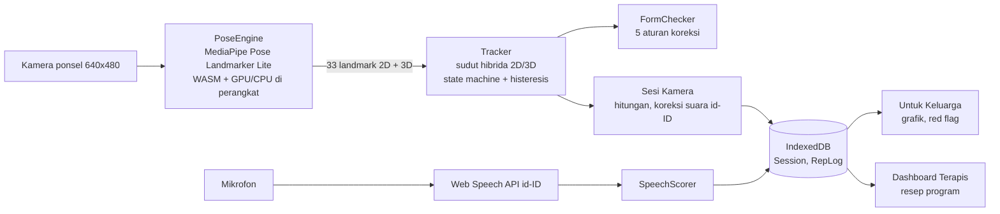

# PULIHIN

Pendamping rehabilitasi stroke di rumah: kamera ponsel biasa menilai gerak latihan, terapi bicara afasia berbahasa Indonesia, dan ringkasan untuk keluarga serta terapis.

Prototype untuk **.id Developer Day Indonesia 2026**, kategori Inclusions and Community Services, subkategori Health and Wellbeing. **Bukan alat kesehatan teregulasi**: tanpa diagnosis, tanpa klaim kesembuhan, tanpa data pasien asli. Semua data di aplikasi adalah data demo bernama samaran.

| | |
|---|---|
| Aplikasi (produksi) | https://pulihin.vercel.app (landing) · https://pulihin.vercel.app/app (aplikasi). Domain final `pulihinapp.id`: lihat [Deploy](#deploy) |
| Repo | https://github.com/arthamegayasa/pulihin |
| Spesifikasi | [`docs/spec.md`](docs/spec.md) (salinan teks PDF build spec v1.0) |
| Algoritma & hasil uji gerak | [`docs/algoritma.md`](docs/algoritma.md) |
| Paket video demo | [`docs/video/`](docs/video/) + proyek Remotion di [`video/`](video/) |

### Coba dalam 2 menit (untuk juri)

| Ingin melihat | Buka |
|---|---|
| Tampilan pasien (Pak Budi, data demo 14 hari) | https://pulihin.vercel.app/app?peran=pasien |
| Tampilan keluarga (grafik, tanda perlu perhatian, ringkasan WhatsApp) | https://pulihin.vercel.app/app?peran=keluarga |
| Dashboard terapis (resep program, target rentang personal) | https://pulihin.vercel.app/app?peran=terapis |

Sesi kamera: dari Beranda pasien ketuk **Mulai: Tekuk Siku** lalu **Mulai dengan Kamera**; duduk sekitar 1 meter di depan kamera laptop/HP sehingga kepala sampai pinggul terlihat. Semua pemrosesan terjadi di perangkat Anda. Pengaturan > Setel Ulang Data Demo mengembalikan kondisi awal.

## Isi

1. [Fitur dan status](#fitur-dan-status)
2. [Menjalankan secara lokal](#menjalankan-secara-lokal)
3. [Deploy](#deploy)
4. [Struktur folder](#struktur-folder)
5. [Arsitektur dan privasi](#arsitektur-dan-privasi)
6. [Keputusan teknis dan adaptasi stack](#keputusan-teknis-dan-adaptasi-stack)
7. [Hasil uji](#hasil-uji)
8. [Checklist Bab 11](#checklist-bab-11-lembar-uji-100-perilaku)
9. [Data demo](#data-demo)
10. [Isian [DIISI] yang masih kosong](#isian-diisi-yang-masih-kosong)
11. [Laporan serah terima (Bab 19.4)](#laporan-serah-terima-bab-194)

## Fitur dan status

| Kode | Modul | Status | Bukti utama |
|---|---|---|---|
| F1 | Latihan gerak berbasis kamera | Selesai | `src/features/pose/` (PoseEngine, tracker, RepCounter, FormChecker), `src/pages/SesiKamera.tsx`, uji `src/features/pose/*.test.ts` termasuk replay rekaman manusia nyata |
| F2 | Pustaka 10 latihan sebagai data | Selesai | `src/features/pose/exerciseDefinitions.ts` (uji `exerciseDefinitions.test.ts`); uji "mengubah ambang di definisi mengubah hitungan tanpa mengubah logika" di `tracker.test.ts` |
| F3 | Terapi afasia 100 kata Bahasa Indonesia | Selesai | `src/features/speech/wordBank.ts` (100 kata, 30/25/15/15/15), `SpeechScorer.ts`, `recognizer.ts`, Mode Latihan Mandiri |
| F4 | Pengingat dan streak | Selesai | `src/features/adherence/`, Beranda, Pengaturan (jadwal tersimpan), notifikasi PWA saat aplikasi terbuka |
| F5 | Dashboard caregiver "Untuk Keluarga" | Selesai | `src/pages/Pendamping.tsx`, red flag non medis `redFlags.ts`, ringkasan WhatsApp |
| F6 (P1) | Dashboard klinisi + resep program | Selesai | `src/pages/klinisi/`, resep (latihan, repetisi, set, frekuensi, **target rentang personal 70–100%**) mengubah Latihan Hari Ini pasien (diverifikasi), label Prototype |
| F7 (P1) | Landing page | Selesai | `src/pages/Landing.tsx`, tangkapan layar asli di `public/landing/` |
| P2 | Riwayat per sendi, offline penuh, ekspor PDF | Sebagian | Strip sudut puncak per repetisi di Ringkasan; aplikasi bekerja offline setelah dibuka sekali (PWA). Ekspor PDF tidak dikerjakan |

## Menjalankan secara lokal

Dibangun dan diuji dengan **Node.js v24.19.0** dan npm 11.21 di Windows 11 (minimal Node 22, lihat `engines`).

```bash
npm install
npm run dev          # http://127.0.0.1:5173  (predev menyiapkan aset MediaPipe)
npm test             # seluruh uji unit + replay rekaman (vitest)
npm run typecheck    # TypeScript 7, strict
npm run build        # dist/ (prebuild menyiapkan aset MediaPipe, lalu tsc + vite build)
npm run preview      # pratinjau build produksi
```

Aset MediaPipe tidak disimpan di repo. `scripts/fetch-mediapipe-assets.mjs` (dipanggil otomatis oleh `predev`/`prebuild`) menyalin runtime WASM dari paket `@mediapipe/tasks-vision@1.1.0` dan mengunduh model **Pose Landmarker Lite float16 v1** dari penyimpanan resmi MediaPipe, lalu memverifikasi SHA-256 yang dikunci di `scripts/mediapipe-models.lock.json` (`59929e1d…574a`). Hasilnya disajikan dari domain sendiri di `/mediapipe/`, sehingga demo tidak bergantung pada CDN pihak ketiga.

Kamera dan mikrofon hanya berjalan di `localhost`/`127.0.0.1` atau HTTPS. Untuk mencoba di HP pada jaringan yang sama, pakai URL deploy (HTTPS).

## Deploy

Hosting statis **Vercel** (proyek `pulihin`), terhubung ke repo GitHub: setiap push ke `main` otomatis deploy produksi. Konfigurasi di [`vercel.json`](vercel.json):

- rewrite SPA ke `index.html` (tautan dalam seperti `/app/beranda` aman dibuka langsung),
- header keamanan: `Content-Security-Policy: connect-src 'self'` (tidak ada koneksi ke server lain), `Permissions-Policy: camera=(self), microphone=(self)`,
- cache panjang untuk `/assets/*` (nama ber-hash, 1 tahun) dan cache 7 hari untuk `/mediapipe/*`.

Deploy manual: `vercel deploy --prod`.

**Domain `pulihinapp.id`.** Spesifikasi melarang agen mendaftarkan atau membayar domain. Setelah pemilik produk memiliki domain: Vercel > Project `pulihin` > Settings > Domains > tambahkan `pulihinapp.id` dan `www.pulihinapp.id`, lalu atur DNS di registrar (A record `@` ke `76.76.21.21`, CNAME `www` ke `cname.vercel-dns.com`, atau sesuai petunjuk Vercel). Tidak perlu membangun ulang.

## Struktur folder

```
src/
  pages/               Landing, PilihPeran, Beranda, DaftarLatihan, DetailLatihan, SesiKamera,
                       RingkasanSesi, Pendamping (Untuk Keluarga), Pengaturan, Tentang, ModeUji,
                       afasia/ (Kategori, Latihan, Ringkasan), klinisi/ (Dashboard, Pasien)
  features/
    pose/              PoseEngine (MediaPipe), AngleCalculator, RepCounter, FormChecker, scoring,
                       tracker, exerciseDefinitions.ts (DATA 10 latihan), landmarks, uji + __fixtures__
    speech/            wordBank.ts (DATA 100 kata), SpeechScorer, recognizer (Web Speech API id-ID),
                       pilihKata, modeMandiri
    adherence/         jadwal, streak, kepatuhan mingguan, red flag, ringkasan WhatsApp, program/set, klinisi
  data/                db.ts (IndexedDB via idb), useLiveQuery, seed.ts (data demo 14 hari)
  components/          BigButton, Card, ScoreRing, WeeklyChart, TrendChart, StreakCalendar, SafetyNotice, ...
  lib/                 date, prefs (localStorage), speak (TTS id-ID), score, privasiJaringan
  config/identitas.ts  isian [DIISI] pemilik produk di satu tempat
docs/                  spec.md, algoritma.md, video/ (naskah, SRT, shotlist, YouTube)
video/                 proyek Remotion untuk merakit video demo (lihat docs/video/README.md)
scripts/               fetch-mediapipe-assets.mjs + lock SHA-256 model
```

Definisi latihan (`exerciseDefinitions.ts`) dan bank kata (`wordBank.ts`) adalah objek TypeScript murni tanpa ketergantungan UI, siap dipindah ke Flutter (Bab 4.2).

## Arsitektur dan privasi



- **Video tidak pernah meninggalkan perangkat.** Inferensi pose berjalan di browser; tidak ada server aplikasi, hanya hosting file statis.
- **Telemetri diblokir.** Pustaka MediaPipe Tasks Vision mengirim log pemakaian ke `odml.pa.googleapis.com` tiap 60 detik tanpa opsi mematikan. PULIHIN memasang penjaga `fetch` lintas-origin sebelum modul lain dimuat (`src/lib/privasiJaringan.ts`, diuji) dan header CSP `connect-src 'self'` di produksi. Tab Network selama sesi kamera hanya berisi aset PULIHIN sendiri (AC-F1-5).
- **Tanpa analitik pihak ketiga**, tanpa akun, tanpa cookie pelacak.
- **Catatan jujur suara (Bab 17.3).** Pada Chrome, Web Speech API mengirim audio ke layanan cloud penyedia browser. Karena itu tersedia **Mode Latihan Mandiri** (pasien mengucapkan, pendamping menekan Sudah Benar/Ulangi) yang tidak memakai pengenalan suara sama sekali. Catatan ini juga ada di halaman Tentang.
- **Hapus Semua Data Lokal** di Pengaturan mengosongkan keenam store IndexedDB dan preferensi, tanpa penanaman ulang otomatis.

## Keputusan teknis dan adaptasi stack

Stack sesuai Bab 4 (React + Vite + TypeScript + Tailwind, MediaPipe Tasks Vision, Web Speech API, IndexedDB, PWA, hosting statis). Versi yang dipakai adalah rilis stabil terbaru saat pembangunan: React 19.3, Vite 8.3, TypeScript 7.0, Tailwind CSS 4.3, react-router 8.4, vite-plugin-pwa 2.0, vitest 5.0, `@mediapipe/tasks-vision` 1.1.0 (dikunci persis).

| Keputusan | Alasan dan bukti |
|---|---|
| **Pose Landmarker Lite** (bukan Full/Heavy) | Bab 17.4: dahulukan HP kelas bawah. Model 5,8 MB; inferensi 15–19 ms di produksi (desktop GPU, deteksi 2 orang). |
| **Sudut hibrida 2D/3D per latihan** (`sumberSudut` di definisi) | Uji rekaman manusia nyata: landmark dunia 3D MediaPipe memampatkan fleksi siku dari depan (istirahat 22–29°, puncak hanya 101–115°) sehingga ambang spec 120°/30° tidak pernah tercapai (0 repetisi); 2D bersih di titik ekstrem (istirahat 2–20°, puncak 158–178°). Hibrida memakai 2D saat segmen tungkai sejajar bidang gambar dan beralih halus ke 3D hanya saat segmen mengarah ke kamera. Rincian: `docs/algoritma.md` Bagian 3 dan 13. |
| **Kemiringan badan dari kemiringan 3D garis bahu**, dilewati saat badan berputar > ±50° | Versi 2D memunculkan "Tegakkan badan" palsu berulang pada pandangan serong (foreshortening). Setelah perbaikan: 0 koreksi palsu pada 4 video nyata, kemiringan nyata 18° tetap terdeteksi. |
| **Deteksi 2 orang, pilih pasien utama** (torso terbesar + dekat tengah, lengket antar frame), turun otomatis ke 1 orang bila inferensi > 60 ms atau fps < 15 karena inferensi selama 3 detik | Pada video uji dengan manekin di latar, kandidat pertama MediaPipe adalah manekin pada 287/325 frame; pemilih utama memilih orang yang benar 325/325. Di rumah, anggota keluarga sering berdiri di belakang pasien. |
| Ambang sudut tetap angka Bab 6 | Tidak ada bukti ambang tak tercapai untuk gerakan penuh; semua ambang ada di data dan dapat diubah terapis/pengembang tanpa mengubah logika. |
| Grafik SVG buatan sendiri (bukan Recharts) | Diizinkan Bab 4; nol dependensi tambahan, ringan di HP kelas bawah, tabel tersembunyi untuk pembaca layar. |
| Font Plus Jakarta Sans (OFL, disajikan sendiri) | Huruf sans bersih yang dirancang di Indonesia; satu berkas variabel. |
| Precache service worker ringan (±1,4 MB), aset MediaPipe di-cache saat Beranda pasien atau Detail Latihan dibuka | Landing, layar keluarga, dan layar terapis tidak memaksa unduhan 19 MB di kuota prabayar; sesi kamera tetap bisa dimulai offline setelah Beranda pasien dibuka sekali (terukur: cache terisi ±1–3 s di desktop). |
| Peran disimpan lokal (Pasien / Keluarga / Terapis), tanpa login | Bab 9.2: autentikasi sungguhan adalah pekerjaan pasca lomba. |
| Satu sesi kamera = satu set | Resep program memakai repetisi × set; Beranda menampilkan "1 dari 2 set". |
| **Target rentang personal dari terapis** (`ProgramItem.rentangPersen`, 70–100%) | Pasien stroke sering belum bisa bergerak penuh. Pada rekaman lansia nyata, abduksi bahu memuncak 84–86° (< ambang 90°): 0 repetisi pada 100%, terhitung pada 90%. Hanya ambang atas yang diskalakan, dengan batas bawah aman (ambang bawah + 3× histeresis); skor rentang dinilai terhadap target personal. `docs/algoritma.md` Bagian 8a. |
| Pesan "belum terhitung" maksimal 1× per 15 detik, lalu berganti penyemangat | Pada uji laptop, pesan yang sama sempat terucap 29× dalam 77 detik; kini 5× dalam 80 detik, dan percobaan ditampilkan sebagai kemajuan. |
| Setiap percobaan (terhitung atau belum) langsung disimpan bersama penghitung sesi dalam satu transaksi IndexedDB; sesi dengan ≥ 1 percobaan tidak pernah dibuang | Berhenti, Kembali/gestur, pindah layar, dan tutup tab menyimpan sesi (juga 0 terhitung: "Sudah dicoba: 0 dari 8" + strip sudut puncak). Muat ulang atau aplikasi mati di tengah sesi: percobaan yang sudah terjadi tetap ada, dan saat aplikasi dibuka lagi sesi itu dituntaskan dengan skor dihitung ulang dari RepLog. Hanya sesi tanpa percobaan sama sekali yang dihapus. |

## Hasil uji

### Uji otomatis

`npm test` menjalankan seluruh uji unit, uji logika kepatuhan/red flag/seed, penilaian suara, dan **replay landmark rekaman manusia nyata** melalui tracker yang sama dengan aplikasi. Hasil terakhir (13 Okt 2026): **25 berkas uji, 250 uji lulus**; `npm run typecheck` bersih.

### Akurasi hitung repetisi

| Jenis uji | Sumber | Hasil |
|---|---|---|
| **Rekaman manusia nyata** (bukan HP target) | 4 video Pexels orang sungguhan diputar sebagai kamera Chrome; landmark direkam lalu diputar ulang di `realVideo.test.ts` | Tekuk Siku, mode hibrida: serong berdiri 7/7 dan duduk menghadap kamera 7/7 repetisi yang dimulai setelah status Siap (2 repetisi yang sudah berjalan sebelum Siap tidak dihitung, sesuai desain), **0 hitungan ganda, 0 koreksi palsu**. Mode 3D murni: 0 repetisi pada pandangan depan. Tabel lengkap: `docs/algoritma.md` Bagian 13 |
| Simulasi 50 repetisi × 3 latihan inti × 6 kondisi | `akurasi.test.ts` (derau, frame hilang, yaw 0–35°, 15/30 fps) | 50/50 di semua 18 baris. Membuktikan logika hitung; bukan pengganti uji perangkat |
| **Uji 50 repetisi di HP target (AC-F1-2)** | Mode Uji (`/app/uji`, tombol "+1 Repetisi nyata") | **[DIISI]**: belum dilakukan. Protokol di `docs/algoritma.md` Bagian 10 |

### Frame rate dan latensi

Semua angka di bawah adalah **emulasi desktop** (laptop Ryzen 7 5800H, Chrome 147, build produksi, kamera palsu 24 fps, CPU diperlambat lewat DevTools), **bukan HP target**. Rincian dan metode: `docs/algoritma.md` Bagian 14.

| Ukuran | GPU delegate | CPU delegate (bila GPU gagal) |
|---|---|---|
| Frame rate pemrosesan, 1 orang, CPU 1× / 4× / 6× | 25 / 24 / 21 fps | 25 / 7 / 3 fps |
| AC-F1-1 kerangka pertama (model dihangatkan di Detail Latihan), CPU 1×–6× | 159–399 ms | 207–265 ms (1×) · 446–592 ms (4×, gagal sebagian) · 564–982 ms (6×, gagal) |
| AC-F1-3 koreksi tampil setelah kondisi bertahan 0,5 s, live | 72–257 ms | 633 ms (4×) · 1 135 ms (6×, gagal) |
| AC-F1-4 di HP Android kelas bawah acuan | **[DIISI]**: model HP & versi Chrome ditentukan pemilik produk | |

Bacaan jujur: dengan GPU, target 15 fps dan latensi terpenuhi dengan cadangan; ponsel yang delegasi GPU-nya gagal kemungkinan **tidak** memenuhi AC-F1-4, dan AC-F1-1 tanpa pemanasan model (4,2 s) atau pada CPU 4×–6× (> 500 ms) **gagal**. Karena itu model dihangatkan di Detail Latihan, dan mesin mulai dengan deteksi 2 orang lalu otomatis turun ke 1 orang bila inferensi menjadi penghambat (> 60 ms, atau fps < 15 karena inferensi, selama 3 detik; `kebijakanOrang.ts`, diuji). Hitungan repetisi terbukti tetap tepat pada 12 fps (replay rekaman nyata).

## Checklist Bab 11 (lembar uji 100 perilaku)

Status per baris. ✅ = lolos dan diverifikasi otomatis/di browser desktop dengan emulasi ponsel 360×740 (Chrome 147). 📱 = wajib diulang di HP uji sebelum disebut "siap rekam" (Bab 11, aturan rilis internal). Perangkat uji: **[DIISI]**. Tanggal uji perangkat: **[DIISI]**.

| Area | Perilaku | Status |
|---|---|---|
| Beranda | Latihan hari ini terlihat tanpa scroll di HP 6 inci; status hari ini benar; tombol Untuk Keluarga terlihat | ✅ (360×740) · 📱 |
| Navigasi | Beranda ke sesi kamera maksimal 3 ketuk; dari mana pun ke Beranda maksimal 2 ketuk | ✅ 2 ketuk ke kamera; tombol Beranda di setiap header |
| Kamera | Izin ditolak tertangani dengan bahasa sederhana; skeleton < 500 ms; tombol berhenti bekerja | ✅ izin ditolak & berhenti · 📱 latensi skeleton |
| Repetisi | 10 repetisi lambat terhitung 10; gerakan setengah tidak terhitung penuh; gerakan cepat tidak menggandakan hitungan | ✅ uji unit + rekaman nyata (10/10 E2E) · 📱 |
| Koreksi | Bahu terangkat memicu pesan bahu; badan miring memicu pesan tegak; satu pesan pada satu waktu | ✅ uji unit · 📱 |
| Ringkasan | Angka ringkasan sama dengan penyimpanan; label skor tampil; kalimat bukan alat diagnosis tampil | ✅ diperiksa langsung ke IndexedDB |
| Afasia | 100 kata termuat; Dengar memutar contoh; 10 kata uji dikenali sesuai ambang; mode cadangan menyelesaikan sesi | ✅ 100 kata, Dengar, Mode Mandiri 10 kata · 📱 pengenalan suara nyata (AC-F3-2) |
| Kepatuhan | Sesi selesai mengubah kalender hari ini; streak bertambah benar; jadwal tersimpan antar sesi aplikasi | ✅ |
| Caregiver | Grafik 7 hari sesuai data; red flag muncul dan hilang sesuai skenario; ringkasan dapat disalin | ✅ |
| Klinisi (P1) | Resep tersimpan; resep mengubah latihan pasien; label Prototype tampil | ✅ |
| Ketahanan | Mode pesawat setelah aplikasi termuat: sesi tetap dapat dimulai; muat ulang tidak menghapus riwayat | ✅ (emulasi offline) · 📱 |
| Performa | Halaman awal < 3 detik pada 4G biasa; aplikasi responsif selama pose berjalan | ✅ 1,7 s pada Slow 4G + CPU 4× · 📱 |

## Data demo

Pembukaan pertama menanam data demo 14 hari (deterministik, relatif terhadap hari ini): **Pak Budi** (58 th, stroke 3 bulan lalu; skenario "ada tanda perlu perhatian": 3 hari terakhir tanpa latihan), **Bu Sari** (rajin), **Pak Joko** (kepatuhan sedang). Semua berlabel Demo.

Pengaturan > Data Demo: pilih skenario ("Ada tanda perlu perhatian" / "Pasien rajin"), **Setel Ulang Data Demo**, **Simpan cadangan (berkas .json)** / **Pulihkan dari cadangan** (dipakai saat perekaman video; berkas rusak ditolak tanpa mengubah data), **Hapus Semua Data Lokal**. Mode Uji algoritma: `/app/uji` (halaman internal, tidak ada di menu pasien).

## Isian [DIISI] yang masih kosong

Diisi pemilik produk. Nilai yang tampil di aplikasi dikumpulkan di `src/config/identitas.ts` (kosong = baris disembunyikan).

- Identitas pemilik produk / narasumber klinis (nama, gelar, afiliasi), nama tim 3 orang, email & WhatsApp.
- Domain `pulihinapp.id`: per 13 Okt 2026 belum terdaftar (DNS NXDOMAIN). Setelah didaftarkan dan diarahkan ke Vercel, ubah `urlPublik` di `src/config/identitas.ts`. Penempatan tautan aplikasi saat ini `/app`.
- Model HP uji kelas bawah dan versi Chrome; hasil uji 50 repetisi dan fps di perangkat; tanggal uji.
- Jam pengingat default (saat ini saran spec: 08.00 gerak, 16.00 bicara).
- Aset animasi/video contoh gerakan bila pemilik produk punya sendiri (saat ini animasi figur bawaan).
- Nama & gelar dokter di video, pemeran pasien & caregiver, lokasi rekam, tautan YouTube.

## Laporan serah terima (Bab 19.4)

```
LAPORAN SERAH TERIMA PULIHIN
URL aplikasi    : https://pulihin.vercel.app/app  (domain pulihinapp.id: menunggu DNS pemilik)
URL repo        : https://github.com/arthamegayasa/pulihin
Perangkat uji   : [DIISI] / Chrome [DIISI]   (verifikasi saat ini: Chrome 147 desktop, emulasi 360x740)
P0 selesai      : F1 [x] F2 [x] F3 [x] F4 [x] F5 [x]
P1 selesai      : F6 [x] F7 [x]
Akurasi repetisi: rekaman manusia nyata 14 dari 14 repetisi yang dimulai setelah status Siap (16 di klip,
                  2 sengaja tidak dihitung karena dimulai sebelum Siap), 0 ganda; perangkat target [DIISI] dari 50
Frame rate pose : emulasi desktop GPU 21-25 fps (1 orang, CPU 1x-6x); perangkat target [DIISI] fps
Uji otomatis    : 25 berkas, 250 uji lulus
Video           : draf lokal video/out/pulihin-demo-draft.mp4 (tidak di repo; 1920x1080, 4:58, 20,8 MB; render ulang: `cd video && npm run render`):
                  adegan layar non-kamera = rekaman layar aplikasi asli; adegan dokter, pemeran, dan sesi kamera = kartu
                  placeholder yang wajib diganti rekaman manusia (Bab 14.4). Final [DIISI] setelah perekaman
Yang belum      : uji perangkat target (AC-F1-2, AC-F1-4, AC-F3-2), rekaman manusia untuk video
[DIISI] kosong  : lihat bagian "Isian [DIISI] yang masih kosong"
```

## Lisensi dan kredit

- MediaPipe Tasks Vision dan model Pose Landmarker: Apache License 2.0 (Google).
- Plus Jakarta Sans: SIL Open Font License 1.1.
- Ikon: Phosphor Icons (MIT).
- Video uji internal (tidak disimpan di repo, tidak tampil di aplikasi/landing/video): Pexels 4159059, 9644943, 9058017, 6455077 (lisensi Pexels); repo hanya menyimpan landmark numerik turunannya untuk uji regresi.
