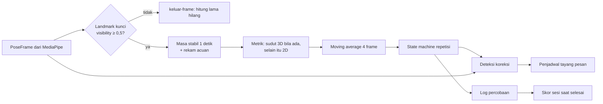
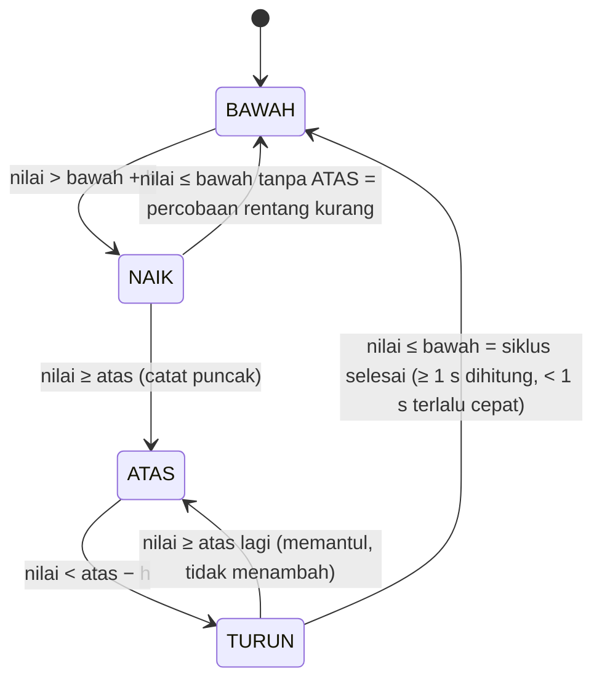

# Algoritma Penilaian Gerak PULIHIN

Dokumen ini menjelaskan cara PULIHIN mengubah landmark tubuh dari kamera ponsel menjadi hitungan
repetisi, pesan koreksi, dan skor sesi (spesifikasi Bab 5, 6, 7). Semua proses berjalan di perangkat;
tidak ada frame video yang dikirim ke server.

Kode: `src/features/pose/`

| File | Isi |
|---|---|
| `landmarks.ts` | Peta 33 landmark MediaPipe → nama titik Indonesia, cek keterlihatan, `POSE_CONNECTIONS` untuk overlay |
| `AngleCalculator.ts` | Sudut dot product 2D/3D, moving average, metrik (sudut, kenaikan, jarak, rotasi bahu), acuan awal |
| `RepCounter.ts` | State machine repetisi BAWAH → NAIK → ATAS → TURUN → BAWAH |
| `FormChecker.ts` | Deteksi 5 koreksi form + penjadwal tayang pesan |
| `scoring.ts` | Skor sesi 0–100 dan satu saran |
| `tracker.ts` | `createTracker(def, opsi)`: merangkai semuanya per frame |
| `exerciseDefinitions.ts` | 10 latihan + **semua** ambang dan aturan angka (satu-satunya tempat angka ambang) |
| `synthetic.ts` | Generator pose sintetis ber-seed untuk uji tanpa kamera |

## 1. Alur per frame



1. **Keterlihatan (Bab 7.1).** Bila salah satu landmark yang dibutuhkan metrik memiliki visibility
   di bawah 0,5, nilai frame itu `null` dan **tidak mengubah state apa pun** (tidak masuk perataan,
   tidak menggerakkan state machine). Frame tanpa tubuh (`update(null, t)`) diperlakukan sama.
2. **Siap (Bab 5.1 langkah 4).** `siap` baru `true` setelah semua `titikKunci` latihan terlihat
   terus-menerus selama 1 detik. Celah deteksi sangat singkat (≤ 0,25 detik, mis. 1–3 frame hilang)
   tidak memutus masa stabil. Selama masa stabil, nilai acuan direkam (rata-rata): lebar bahu di
   gambar, jarak tegak bahu–telinga kiri/kanan, sudut garis bahu 3D, dan posisi y titik untuk
   metrik `kenaikan`. Sebelum siap, repetisi tidak dihitung.
3. **Bersenjata.** Setelah siap, penghitung baru mulai bekerja setelah sekali melihat nilai
   ≤ ambang bawah. Sesi yang dimulai dengan lengan sudah terangkat tidak menghasilkan hitungan palsu.

## 2. Peta landmark dan sisi

Indeks MediaPipe: hidung 0, telinga 7/8, bahu 11/12, siku 13/14, pergelangan 15/16, pinggul 23/24,
lutut 25/26, pergelangan kaki 27/28, tumit 29/30, ujung kaki 31/32 (kiri/kanan).

**Sisi kiri/kanan selalu sisi ANATOMIS pasien.** MediaPipe memakai konvensi yang sama
("left_shoulder" = bahu kiri orang itu). Pada kamera depan yang tidak dicerminkan, bahu kiri pasien
tampak di sisi kanan gambar. Jadi pilihan "kiri" di aplikasi = lengan/tungkai kiri pasien, apa pun
pencerminan tampilan di layar.

## 3. Keputusan: sudut 3D bila tersedia, 2D sebagai cadangan

**Masalah.** Ponsel paling mudah diletakkan di meja **di depan** pasien. Dari depan, gerak bidang
sagital (fleksi siku, fleksi bahu, ekstensi lutut, menggapai) bergerak **ke arah kamera**, sehingga
proyeksi 2D-nya memendek dan sudut 2D salah besar. Sebaliknya, koreksi bidang frontal (bahu miring,
bahu terangkat) justru paling jelas dilihat dari depan.

**Keputusan.** Sudut sendi dan metrik `jarak` dihitung dari `worldLandmarks` (koordinat 3D dalam
meter, berpusat di pinggul) yang dikeluarkan MediaPipe Pose Landmarker untuk setiap frame. Sudut 3D
dengan dot product tidak berubah ketika tubuh berputar terhadap kamera. Koreksi bidang frontal tetap
diukur pada koordinat gambar 2D dari sudut pandang yang sama. Bila `worldLandmarks` tidak ada, sudut
dihitung dari koordinat gambar yang dikoreksi rasio aspek (`x × aspect`, `y`). Mode Uji dapat
memaksa 2D (`modeSudut: '2d'`) untuk membandingkan keduanya di perangkat.

Pengecualian yang disengaja:

- `kenaikan` (jinjit, langkah di tempat) selalu memakai **gambar 2D**: landmark dunia berpusat di
  pinggul sehingga tidak bisa melihat seluruh badan naik saat jinjit.
- `rotasi-bahu` memakai 3D `atan2(dz, dx)`; tanpa 3D diperkirakan dari pemendekan lebar bahu
  `acos(lebar / lebar acuan)` (besar rotasi saja, cukup karena yang dihitung adalah besarnya).

**Bukti (SIMULASI, `AngleCalculator.test.ts` dan `akurasi.test.ts`).** Pose sintetis diputar pada
sumbu tegak (yaw) terhadap kamera:

- Tanpa derau, sudut 3D fleksi siku 60°/130° dan fleksi bahu 90° tetap dalam ±0,5° untuk yaw
  −30° s.d. 75°, sedangkan galat sudut 2D berubah lebih dari 20° antar sudut pandang.
- Dengan derau (3° sudut sendi, 2 px landmark, 15 fps), galat rata-rata nilai mentah terhadap sudut
  sebenarnya:

| Latihan | 3D yaw 0° | 2D yaw 0° | 3D yaw 30° | 2D yaw 30° | 3D yaw 60° | 2D yaw 60° |
|---|---|---|---|---|---|---|
| fleksi-bahu | 3,4° | 22,1° | 3,3° | 10,1° | 3,0° | 5,3° |
| fleksi-siku | 4,9° | 24,1° | 4,5° | 8,4° | 3,8° | 3,6° |
| abduksi-bahu | 2,8° | 2,8° | 2,9° | 5,3° | 3,4° | 13,0° |

Sudut 3D stabil (≈3–5°, setara derau masukan) dari arah mana pun. Sudut 2D hanya baik bila arah
pandang tegak lurus bidang gerak (abduksi dari depan, fleksi dari samping). Catatan jujur: kedalaman
(z) MediaPipe di dunia nyata lebih berderau daripada x/y; simulasi memberi derau z 3× lebih besar,
tetapi galat sistematis model nyata belum termodelkan. Karena itu hasil perangkat wajib diuji dengan
protokol di Bagian 10.

## 4. Metrik per latihan

Semua angka berasal dari `exerciseDefinitions.ts`. h = histeresis.

| Latihan | Metrik | Basis | Ambang atas / bawah | h | Tempo target |
|---|---|---|---|---|---|
| Angkat Lengan ke Depan (fleksi-bahu) | sudut batang tubuh (bahu→pinggul) – lengan atas (bahu→siku) | 3D | 100° / 30° | 5 | 2–6 s |
| Tekuk Siku (fleksi-siku) | fleksi = 180 − sudut dalam bahu–siku–pergelangan | 3D | 120° / 30° | 5 | 1,5–4 s |
| Angkat Lengan ke Samping (abduksi-bahu) | sudut batang tubuh – lengan atas | 3D | 90° / 25° | 5 | 2–6 s |
| Luruskan Tungkai (ekstensi-lutut) | sudut dalam pinggul–lutut–pergelangan kaki | 3D | 150° / 100° | 5 | 2–6 s |
| Angkat Kaki ke Samping (abduksi-pinggul) | sudut garis panggul (pinggul lawan→pinggul) – paha, dikurangi 90° | 3D | 25° / 8° | 5 | 2–6 s |
| Duduk ke Berdiri | sudut dalam lutut, rata-rata kiri & kanan yang terlihat | 3D | 160° / 100° | 5 | 3–10 s |
| Jinjit Berpegangan | kenaikan tumit terhadap acuan, % lebar bahu acuan, rata-rata dua tumit | 2D | 10% / 4% | 2,5 | 2–6 s |
| Menggapai ke Depan | jarak pergelangan–bahu, % lebar bahu | 3D | 135% / 90% | 5 | 2–6 s |
| Putar Badan | \|rotasi garis bahu − acuan\|, ke kiri maupun kanan | 3D | 20° / 8° | 5 | 2–6 s |
| Langkah di Tempat | kenaikan lutut kiri & kanan terpisah, % lebar bahu acuan | 2D | 25% / 8% | 4 | 1,5–5 s |

Ambang no. 1–6 dan 9 persis tabel Bab 6. Tabel Bab 6 hanya menyebut cara ukur untuk jinjit,
menggapai, dan langkah di tempat; angka di atas adalah titik awal prototype yang dikalibrasi pada
model tubuh sintetis (lebar bahu 36 cm, tumit naik 6 cm ≈ 17%, lutut naik ≈ 36%, lengan lurus ≈ 155%).
Ambang menggapai bersifat progresif: terapis dapat menaikkannya bertahap di file definisi.

Catatan abduksi pinggul: garis panggul dipakai (bukan garis bahu–pinggul) karena bahu lebih lebar
dari pinggul (garis bahu–pinggul sudah condong ±9° saat berdiri tegak sehingga nilai diam > 8°) dan
agar badan yang condong ke samping tidak terhitung sebagai abduksi. Fleksi pinggul tidak mengubah
metrik ini.

## 5. Perataan

Moving average atas **4 frame valid** terakhir (dapat diatur 3–5 lewat `jendelaRata`). Pada 15 fps
jeda tambahan ±100 ms, pada 30 fps ±50 ms. Hanya frame valid yang masuk perataan.

## 6. State machine repetisi (Bab 7.2)



- Histeresis mencegah hitungan ganda saat tubuh berhenti tepat di ambang (diuji dengan getaran ±4°
  di ambang atas dan di ambang bawah + h).
- Durasi siklus diukur dari frame BAWAH terakhir sebelum NAIK sampai frame kembali BAWAH, yaitu antar
  lintasan ambang (sedikit lebih pendek dari durasi gerak fisik).
- Setiap percobaan (terhitung, terlalu cepat, atau setengah gerak) dicatat di `repLogs` dengan
  `dihitung`, `sudutPuncak`, `durasiSiklusDetik`, dan id koreksi yang tampil selama siklus.
  `percobaanTidakDihitung` bernilai `true` untuk keduanya; `alasanTidakDihitung` membedakan
  `'terlalu-cepat'` dan `'rentang-kurang'`.
- **Bergantian (langkah di tempat):** dua state machine terpisah untuk lutut kiri dan kanan. Setiap
  angkatan lutut yang lengkap di salah satu sisi = 1 repetisi; urutan kiri/kanan tidak diwajibkan.
  Target 10 = total 10 angkatan (± 5 per sisi). Fase yang ditampilkan = sisi yang sedang bergerak.

## 7. Koreksi form (Bab 7.3)

| Prioritas | Koreksi | Deteksi | Ambang bawaan | Harus bertahan | Pesan |
|---|---|---|---|---|---|
| 1 | keluar-frame | landmark kunci tidak terlihat | – | > 1 s | Mundur sedikit agar tubuh terlihat penuh |
| 2 | badan-miring | garis kedua bahu di gambar miring dari horizontal | 12° | 0,5 s | Tegakkan badan, jangan miring |
| 3 | bahu-terangkat | jarak tegak bahu–telinga sisi dilatih menyusut dibanding acuan, hanya saat NAIK/ATAS | 20% (fleksi siku), 30% (fleksi & abduksi bahu) | 0,5 s | Rilekskan bahu, turunkan bahu Anda |
| 4 | rentang-kurang | puncak 2 percobaan berturut-turut < ambang atas − margin | 15° (8° abduksi pinggul & langkah, 4° putar badan, 2% jinjit) | peristiwa | Sedikit lagi, angkat lebih tinggi bila mampu |
| 5 | tempo-cepat | 2 siklus lengkap berturut-turut lebih singkat dari tempo minimum | `tempoTargetDetik.min` | peristiwa | Perlambat gerakan Anda |

Margin rentang-kurang diperkecil untuk latihan berentang sempit agar puncak "rendah" tetap di atas
ambang NAIK (bila tidak, percobaannya tidak pernah tercatat); `exerciseDefinitions.test.ts` memeriksa
syarat ini untuk semua latihan. Kemiringan bahu dan penyusutan bahu–telinga ikut diratakan 4 frame.

**Aturan tayang.** Satu pesan pada satu waktu; tampil minimal 1,5 s (kondisi kontinu tetap tampil
selama kondisi bertahan; pesan peristiwa tampil 2,5 s); pesan yang sama tidak diulang dalam 4 s sejak
terakhir selesai; pesan peristiwa yang tertahan lebih dari 3 s dibuang. Kondisi yang lolos masa
bertahan **langsung tampil pada frame yang sama** bila slot kosong, sehingga AC-F1-3 (< 700 ms
setelah 0,5 s) terpenuhi — diuji pada 15 dan 30 fps.

**Pertentangan yang diputuskan:** bila pesan kurang penting sedang tampil (< 1,5 s) dan muncul
kondisi yang lebih penting, menunggu 1,5 s dapat melanggar AC-F1-3. Karena acceptance criteria
didahulukan, pesan yang **lebih penting** langsung menggantikan; pesan setara atau kurang penting
tetap menunggu 1,5 s. `snapshot.koreksiBaru` hanya terisi pada frame pesan mulai tampil (UI
mengucapkannya sekali).

## 8. Skor sesi (Bab 5.3)

```
skor = 50 × repetisi + 30 × rentang + 20 × tempo           (dibulatkan)
repetisi = min(1, repetisi terhitung / target)
rentang  = rata-rata atas SEMUA percobaan dari min(1, max(0, (puncak − bawah) / (atas − bawah)))
tempo    = 0,7 × (porsi siklus lengkap dengan durasi di dalam tempoTargetDetik)
         + 0,3 × max(0, 1 − KV / 0,5)        KV = simpangan baku / rata-rata durasi siklus lengkap
```

Rentang memakai semua percobaan, bukan hanya repetisi terhitung: repetisi terhitung selalu mencapai
ambang atas sehingga rata-ratanya selalu 100 dan tidak bermakna. Rentang = 0 bila tidak ada
percobaan; tempo = 0 bila tidak ada siklus lengkap. Label kata dari `labelSkor` (`src/lib/score.ts`):
≥ 80 Sangat Baik, ≥ 60 Baik, ≥ 40 Berkembang, selain itu Perlu Pendampingan.

Contoh (fleksi bahu, target 10): 8 repetisi penuh dengan durasi 2, 2, 3, 3, 4, 4, 5, 5 s dan 2
setengah gerak berpuncak 65°:
repetisi 0,8; rentang (8 + 2 × 0,5)/10 = 0,9; tempo 0,7 × 1 + 0,3 × (1 − 0,319/0,5) = 0,808;
skor = 40 + 27 + 16,2 = **83 (Sangat Baik)**, komponen 80 / 90 / 81.

**Saran** dipilih dari komponen terendah, dengan nada hangat (Bab 12.4): belum ada gerakan → "Besok
kita mulai pelan-pelan, satu gerakan dulu sudah bagus."; repetisi → "Besok kita coba tambah beberapa
gerakan lagi, sedikit demi sedikit."; rentang → "Besok coba gerakkan sedikit lebih jauh, sebatas yang
nyaman."; tempo terlalu cepat → "Besok coba bergerak lebih pelan dan teratur, sambil bernapas biasa.";
semua komponen ≥ 85 → "Bagus sekali. Pertahankan latihan rutin seperti hari ini."

## 9. Hasil uji SIMULASI (bukan hasil perangkat)

Sumber: `src/features/pose/akurasi.test.ts`, dijalankan dengan
`npx vitest run src/features/pose/akurasi.test.ts --silent=false`.

Skenario utama: 50 repetisi per latihan inti, orang sehat menirukan gerakan lambat pasien (durasi
repetisi 3–5,5 s, jeda 0,5–2 s, tahan di atas 0,2–0,8 s, amplitudo 92–108% gerakan penuh), 15 fps,
derau sudut sendi σ = 3°, derau landmark σ = 2 px, 3% frame tanpa deteksi, 2% frame dengan 2 landmark
buram (visibility < 0,5 dan posisi kacau), ponsel di depan dan sedikit serong (yaw 15°). Hitungan
dicocokkan dengan jendela repetisi sebenarnya; akurasi = (benar − ganda) / 50.

| Latihan | Kondisi | Benar | Ganda | Hilang | Akurasi |
|---|---|---|---|---|---|
| fleksi-bahu | 3D, 15 fps, yaw 15° | 50 | 0 | 0 | 100% |
| fleksi-bahu | 3D, 30 fps, yaw 15° | 50 | 0 | 0 | 100% |
| fleksi-bahu | 3D, 15 fps, yaw 0° | 50 | 0 | 0 | 100% |
| fleksi-bahu | 3D, 15 fps, yaw 35° | 50 | 0 | 0 | 100% |
| fleksi-bahu | 3D, 15 fps, derau berat* | 50 | 0 | 0 | 100% |
| fleksi-bahu | 2D saja, 15 fps, yaw 0° | 50 | 0 | 0 | 100% |
| fleksi-siku | 3D, 15 fps, yaw 15° | 50 | 0 | 0 | 100% |
| fleksi-siku | 3D, 30 fps, yaw 15° | 50 | 0 | 0 | 100% |
| fleksi-siku | 3D, 15 fps, yaw 0° | 50 | 0 | 0 | 100% |
| fleksi-siku | 3D, 15 fps, yaw 35° | 50 | 0 | 0 | 100% |
| fleksi-siku | 3D, 15 fps, derau berat* | 50 | 0 | 0 | 100% |
| fleksi-siku | 2D saja, 15 fps, yaw 0° | 50 | 0 | 0 | 100% |
| abduksi-bahu | 3D, 15 fps, yaw 15° | 50 | 0 | 0 | 100% |
| abduksi-bahu | 3D, 30 fps, yaw 15° | 50 | 0 | 0 | 100% |
| abduksi-bahu | 3D, 15 fps, yaw 0° | 50 | 0 | 0 | 100% |
| abduksi-bahu | 3D, 15 fps, yaw 35° | 50 | 0 | 0 | 100% |
| abduksi-bahu | 3D, 15 fps, derau berat* | 50 | 0 | 0 | 100% |
| abduksi-bahu | 2D saja, 15 fps, yaw 0° | 50 | 0 | 0 | 100% |

\* derau berat: σ sudut 5°, σ landmark 4 px, 10% frame hilang, 5% frame buram.

Hitungan 2D dari depan tetap melewati ambang pada gerakan penuh, tetapi nilai sudutnya salah 22–24°
untuk fleksi bahu dan siku (tabel Bagian 3), sehingga skor rentang, bar progres, dan koreksi
rentang-kurang tidak andal tanpa 3D.

**Batas simulasi.** Kerangka tubuh kaku dan derau Gaussian tidak memodelkan galat sistematis model
pose nyata (landmark tertukar kiri/kanan, kedalaman bias, oklusi tangan di depan badan, pakaian
longgar, cahaya redup). Angka 100% di atas membuktikan logika hitung (histeresis, durasi minimum,
perataan, frame diabaikan) benar; angka yang dilaporkan untuk AC-F1-2 harus dari uji perangkat.

## 10. Protokol uji 50 repetisi di perangkat (AC-F1-2) — diisi manual

Dilakukan di HP uji Bab 11.1 memakai **Mode Uji** (`/app/uji`, dari Pengaturan).

1. Ponsel tegak di tripod/tumpukan buku, setinggi dada, 1 meter di depan kursi (latihan duduk),
   cahaya ruangan biasa dari depan. Catat model HP, versi Chrome, dan FPS yang tampil di Mode Uji.
2. Pilih latihan inti, sisi, dan mode sudut **Otomatis (3D bila ada)**. Nyalakan kamera dan tunggu
   status Siap.
3. Penguji (orang sehat) melakukan 50 repetisi **lambat** (±3–5 detik per repetisi, jeda singkat),
   menirukan pasien: sebagian dengan tahan di atas, sebagian langsung turun.
4. Pendamping mengetuk **+1 Repetisi nyata** tepat saat setiap repetisi nyata selesai (lengan kembali
   ke bawah). Mode Uji mencocokkan hitungan otomatis dengan ketukan dalam ±1,5 detik dan menampilkan
   Benar, Ganda, Hilang, dan Akurasi. Tekan **Simpan hasil**.
5. Ulangi untuk ketiga latihan inti. Bila waktu memungkinkan, ulangi satu putaran dengan mode sudut
   **2D** dan satu putaran dengan ponsel serong ±30° untuk membandingkan.
6. Lulus bila akurasi > 90% per latihan. Bila gagal: catat pola (ganda di atas? hilang karena
   tidak mencapai ambang?), ubah ambang/histeresis di `exerciseDefinitions.ts` saja, lalu ulangi.

| Latihan | HP / Chrome | FPS | Mode sudut | Posisi ponsel | Benar | Ganda | Hilang | Akurasi | Tanggal / penguji |
|---|---|---|---|---|---|---|---|---|---|
| fleksi-bahu | [DIISI] | [DIISI] | Otomatis | depan, 1 m | [DIISI] | [DIISI] | [DIISI] | [DIISI] | [DIISI] |
| fleksi-siku | [DIISI] | [DIISI] | Otomatis | depan, 1 m | [DIISI] | [DIISI] | [DIISI] | [DIISI] | [DIISI] |
| abduksi-bahu | [DIISI] | [DIISI] | Otomatis | depan, 1,2 m | [DIISI] | [DIISI] | [DIISI] | [DIISI] | [DIISI] |

Untuk AC-F1-3, di Mode Uji lakukan gerakan salah (miringkan badan, angkat bahu saat menekuk siku)
selama ±2 detik dan pastikan pesan muncul kurang dari 1,2 detik setelah gerakan salah dimulai.

## 11. Mengubah ambang (AC-F2)

Semua angka ada di `exerciseDefinitions.ts`: ambang atas/bawah, histeresis, tempo, ambang dan lama
bertahan tiap koreksi (`koreksiUmum[].ambang`, `.tahanDetik`), serta aturan umum `ATURAN_UMUM`
(durasi repetisi minimum, visibility, masa stabil, jendela perataan, aturan tayang, bobot skor).
Logika tidak berisi angka ambang. Tes `tracker.test.ts` → "mengubah ambangAtas pada salinan definisi
mengubah hitungan tanpa mengubah logika" membuktikannya.

Menjalankan semua tes modul ini: `npx vitest run src/features/pose`.

## 12. Keterbatasan dan risiko

- Kualitas kedalaman (z) MediaPipe pada HP kelas bawah belum diuji; bila sudut 3D terlalu berderau
  di perangkat, cadangannya adalah menyarankan ponsel diletakkan serong 45° (posisi ponsel di
  definisi latihan kaki sudah menyarankan sedikit menyamping) dan/atau `modeSudut: '2d'`.
- Bahu terangkat diukur dari jarak bahu–telinga: menunduk dapat terbaca sebagai bahu terangkat. Karena
  itu hanya dievaluasi saat fase NAIK/ATAS.
- Jinjit memerlukan tumit terlihat (ponsel rendah, 2 m). Kenaikan dinormalkan dengan lebar bahu saat
  siap; bila ponsel sangat serong, lebar bahu tampak lebih kecil dan kenaikan terbaca sedikit lebih
  besar.
- Rotasi tanpa 3D hanya memperkirakan besar rotasi dari pemendekan bahu dan kurang peka di bawah ±15°.
