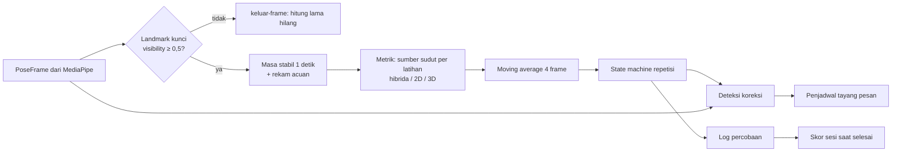
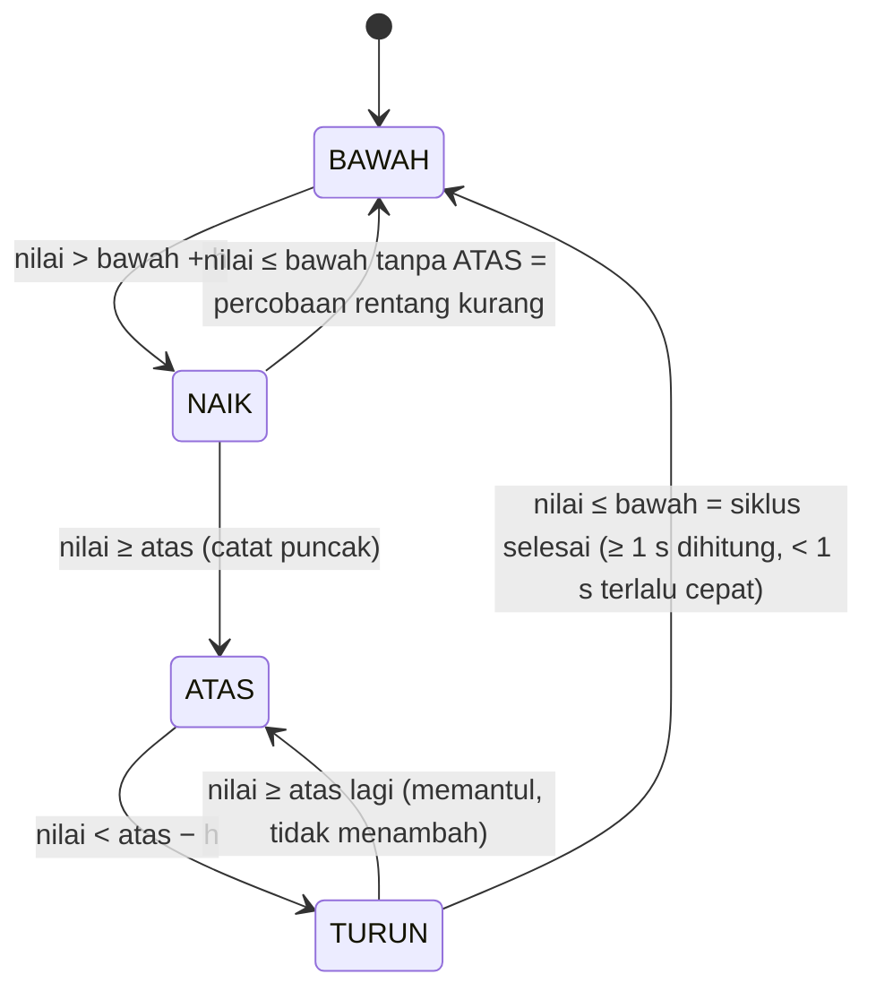

# Algoritma Penilaian Gerak PULIHIN

Dokumen ini menjelaskan cara PULIHIN mengubah landmark tubuh dari kamera ponsel menjadi hitungan
repetisi, pesan koreksi, dan skor sesi (spesifikasi Bab 5, 6, 7). Semua proses berjalan di perangkat;
tidak ada frame video yang dikirim ke server.

Kode: `src/features/pose/`

| File | Isi |
|---|---|
| `landmarks.ts` | Peta 33 landmark MediaPipe → nama titik Indonesia, cek keterlihatan, `POSE_CONNECTIONS` untuk overlay |
| `AngleCalculator.ts` | Sudut dot product 2D/3D/hibrida, moving average, metrik (sudut, kenaikan, jarak, rotasi bahu), kemiringan bahu tahan putaran, acuan awal |
| `RepCounter.ts` | State machine repetisi BAWAH → NAIK → ATAS → TURUN → BAWAH |
| `FormChecker.ts` | Deteksi 5 koreksi form + penjadwal tayang pesan |
| `scoring.ts` | Skor sesi 0–100 dan satu saran |
| `tracker.ts` | `createTracker(def, opsi)`: merangkai semuanya per frame, termasuk `sisiTerlihat` / `sisiLainTerlihat` |
| `PoseEngine.ts` | MediaPipe Pose Landmarker (2 orang, otomatis 1 orang di perangkat lambat) + `pilihPoseUtama` (pasien = badan terbesar, dekat tengah, lengket) |
| `kebijakanOrang.ts` | Kebijakan jumlah orang adaptif (fungsi murni, Bagian 14) |
| `asetPose.ts` | Lokasi aset MediaPipe + `prefetchAsetPose()` untuk sesi kamera luring (Bagian 14) |
| `exerciseDefinitions.ts` | 10 latihan + **semua** ambang dan aturan angka (satu-satunya tempat angka ambang), termasuk `sumberSudut` per latihan |
| `synthetic.ts` | Generator pose sintetis ber-seed untuk uji tanpa kamera |
| `__fixtures__/`, `realVideo.test.ts` | Landmark dari rekaman manusia nyata (Pexels) + uji regresinya (Bagian 13) |

## 1. Alur per frame



1. **Keterlihatan (Bab 7.1).** Bila salah satu landmark yang dibutuhkan metrik memiliki visibility
   di bawah 0,5, nilai frame itu `null` dan **tidak mengubah state apa pun** (tidak masuk perataan,
   tidak menggerakkan state machine). Frame tanpa tubuh (`update(null, t)`) diperlakukan sama.
2. **Siap (Bab 5.1 langkah 4).** `siap` baru `true` setelah semua `titikKunci` latihan terlihat
   terus-menerus selama 1 detik. Celah deteksi sangat singkat (≤ 0,25 detik, mis. 1–3 frame hilang)
   tidak memutus masa stabil. Selama masa stabil, nilai acuan direkam (rata-rata): lebar bahu di
   gambar, jarak tegak bahu–telinga kiri/kanan, sudut garis bahu 3D, dan posisi y titik untuk
   metrik `kenaikan`. Sebelum siap, repetisi tidak dihitung.
3. **Bersenjata.** Setelah siap, penghitung baru mulai bekerja setelah sekali melihat nilai
   ≤ ambang bawah. Sesi yang dimulai dengan lengan sudah terangkat tidak menghasilkan hitungan palsu.

## 2. Peta landmark dan sisi

Indeks MediaPipe: hidung 0, telinga 7/8, bahu 11/12, siku 13/14, pergelangan 15/16, pinggul 23/24,
lutut 25/26, pergelangan kaki 27/28, tumit 29/30, ujung kaki 31/32 (kiri/kanan).

**Sisi kiri/kanan selalu sisi ANATOMIS pasien.** MediaPipe memakai konvensi yang sama
("left_shoulder" = bahu kiri orang itu). Pada kamera depan yang tidak dicerminkan, bahu kiri pasien
tampak di sisi kanan gambar. Jadi pilihan "kiri" di aplikasi = lengan/tungkai kiri pasien, apa pun
pencerminan tampilan di layar.

## 3. Keputusan: sumber sudut per latihan (2D, 3D, atau hibrida)

**Masalah.** Ponsel paling mudah diletakkan di meja **di depan** pasien. Dari depan, gerak bidang
sagital (fleksi siku, fleksi bahu, ekstensi lutut, menggapai) bergerak **ke arah kamera**, sehingga
proyeksi 2D-nya memendek dan sudut 2D tidak terdefinisi di tengah gerak. Iterasi 0 karena itu
memakai `worldLandmarks` 3D MediaPipe untuk semua sudut. Rekaman manusia nyata (Bagian 13)
membuktikan pilihan itu salah untuk latihan lengan: kedalaman 3D MediaPipe **memampatkan rentang**
gerak yang mengarah ke kamera. Tekuk siku dari depan terbaca 3D 23–29° saat istirahat dan hanya
101–108° di puncak (median per loop; ambang 120°/30° tidak pernah terlewati, 0 repetisi), padahal 2D
bersih di titik ekstrem (istirahat 2–3°, puncak 175–178°).

**Keputusan.** Sumber sudut adalah DATA per latihan (`ExerciseDefinition.sumberSudut`):

| Sumber | Dipakai oleh | Alasan |
|---|---|---|
| `hibrida` | fleksi-bahu, fleksi-siku, abduksi-bahu, ekstensi-lutut, abduksi-pinggul, duduk-berdiri | lihat aturan di bawah; teruji nyata untuk tiga latihan inti lengan |
| `3d` | menggapai (jarak), putar-badan (rotasi-bahu) | gerak utamanya justru ke arah kamera / berupa rotasi; 2D tidak dapat melihatnya |
| `2d` | jinjit, langkah-duduk (kenaikan) | landmark dunia berpusat di pinggul sehingga tidak melihat seluruh badan naik |

**Aturan hibrida** (`AngleCalculator.bobot2D`): untuk sendi B dengan ruas BA dan BC,

```
r  = (|BC| / |BA| pada gambar) / (|BC| / |BA| pada dunia 3D)
p  = min(r, 1/r)                        pemendekan relatif ruas, 1 = keduanya sejajar bidang gambar
w  = clamp((p − 0,35) / (0,70 − 0,35))  bobot 2D
sudut = w × sudut2D + (1 − w) × sudut3D
```

Artinya **2D saat anggota gerak bergerak di bidang gambar, 3D hanya saat satu ruas mengarah ke
kamera** (tempat 2D tidak terdefinisi), dengan peralihan halus. Perbandingan antar-ruas membuat aturan
ini tidak butuh panjang acuan per sesi. Ambang 0,35/0,70 (`ATURAN_UMUM.hibrida`) dikalibrasi pada
`seated`: lengan menggantung atau tertekuk penuh p = 0,5–1,0; lengan bawah menunjuk kamera di tengah
gerak p = 0,08–0,35. Pada pandangan serong `curl2` lengan dekat p = 0,79–0,98 sepanjang gerak sehingga hibrida =
2D. Metrik non-sudut dengan sumber hibrida memakai 3D. Tanpa `worldLandmarks` semua sumber jatuh ke 2D.
Mode Uji dapat memaksa `modeSudut: '2d'` atau `'3d'` untuk perbandingan; debug Mode Uji memuat
`sudut.<sendi>.<sisi>.2d`, `.3d`, dan `bobot.2d`.

Pilihan yang diuji lalu ditolak (data `seated`/`curl2`):

- **2D murni** untuk semua: hitungan nyata sama baiknya, tetapi gerak setengah dari depan tidak
  terlihat sama sekali (lengan bawah menunjuk kamera terbaca ≈ 0°), sehingga koreksi rentang-kurang
  dan skor rentang hilang; di simulasi galat 2D dari depan 22–24°.
- **Rekonstruksi kedalaman dari panjang ruas maksimum** (|dz| = √(L² − l²), L = panjang 2D
  terpanjang yang pernah terlihat): rapuh terhadap satu frame pencilan; puncak `curl2` hanya
  114–119° (tidak melewati 120°) dan istirahat lengan jauh 50–65°.

**Bukti SIMULASI** (`AngleCalculator.test.ts`, `akurasi.test.ts`). Pada kerangka sintetis kaku 3D
tepat sempurna (tidak ada bias MediaPipe), jadi simulasi hanya membuktikan logika, bukan pilihan
sumber. Galat rata-rata nilai mentah terhadap sudut sebenarnya (derau 3°/2 px, 15 fps):

| Latihan | 3D 0° | 2D 0° | hibrida 0° | 3D 30° | 2D 30° | hibrida 30° | 3D 60° | 2D 60° | hibrida 60° |
|---|---|---|---|---|---|---|---|---|---|
| fleksi-bahu | 3,4° | 22,1° | 18,2° | 3,3° | 10,4° | 10,4° | 3,0° | 5,3° | 5,3° |
| fleksi-siku | 4,9° | 24,4° | 19,6° | 4,5° | 8,7° | 8,7° | 3,8° | 3,5° | 3,5° |
| abduksi-bahu | 2,8° | 2,8° | 2,8° | 2,9° | 4,9° | 4,8° | 3,4° | 13,1° | 9,3° |

(kolom = sudut putar tubuh terhadap kamera). Konsekuensi jujur: dari depan, NILAI sudut hibrida di
tengah gerak dan di puncak tidak tepat (puncak tekuk siku dari depan terbaca 175–178°, sebenarnya
±140°), sehingga sudut puncak di log dan skor rentang dari depan cenderung tinggi. Hitungan repetisi —
yang dinilai AC-F1-2 — andal karena kedua titik ekstrem bersih.

## 4. Metrik per latihan

Semua angka berasal dari `exerciseDefinitions.ts`. h = histeresis.

| Latihan | Metrik | Sumber sudut | Ambang atas / bawah | h | Tempo target |
|---|---|---|---|---|---|
| Angkat Lengan ke Depan (fleksi-bahu) | sudut batang tubuh (bahu→pinggul) – lengan atas (bahu→siku) | hibrida | 100° / 30° | 5 | 2–6 s |
| Tekuk Siku (fleksi-siku) | fleksi = 180 − sudut dalam bahu–siku–pergelangan | hibrida | 120° / 30° | 5 | 1,5–4 s |
| Angkat Lengan ke Samping (abduksi-bahu) | sudut batang tubuh – lengan atas | hibrida | 90° / 25° | 5 | 2–6 s |
| Luruskan Tungkai (ekstensi-lutut) | sudut dalam pinggul–lutut–pergelangan kaki | hibrida | 150° / 100° | 5 | 2–6 s |
| Angkat Kaki ke Samping (abduksi-pinggul) | sudut garis panggul (pinggul lawan→pinggul) – paha, dikurangi 90° | hibrida | 25° / 8° | 5 | 2–6 s |
| Duduk ke Berdiri | sudut dalam lutut, rata-rata kiri & kanan yang terlihat | hibrida | 160° / 100° | 5 | 3–10 s |
| Jinjit Berpegangan | kenaikan tumit terhadap acuan, % lebar bahu acuan, rata-rata dua tumit | 2D | 10% / 4% | 2,5 | 2–6 s |
| Menggapai ke Depan | jarak pergelangan–bahu, % lebar bahu | 3D | 135% / 90% | 5 | 2–6 s |
| Putar Badan | \|rotasi garis bahu − acuan\|, ke kiri maupun kanan | 3D | 20° / 8° | 5 | 2–6 s |
| Langkah di Tempat | kenaikan lutut kiri & kanan terpisah, % lebar bahu acuan | 2D | 25% / 8% | 4 | 1,5–5 s |

Ambang no. 1–6 dan 9 persis tabel Bab 6. Tabel Bab 6 hanya menyebut cara ukur untuk jinjit,
menggapai, dan langkah di tempat; angka di atas adalah titik awal prototype yang dikalibrasi pada
model tubuh sintetis (lebar bahu 36 cm, tumit naik 6 cm ≈ 17%, lutut naik ≈ 36%, lengan lurus ≈ 155%).
Ambang menggapai bersifat progresif: terapis dapat menaikkannya bertahap di file definisi.

Catatan abduksi pinggul: garis panggul dipakai (bukan garis bahu–pinggul) karena bahu lebih lebar
dari pinggul (garis bahu–pinggul sudah condong ±9° saat berdiri tegak sehingga nilai diam > 8°) dan
agar badan yang condong ke samping tidak terhitung sebagai abduksi. Fleksi pinggul tidak mengubah
metrik ini.

## 5. Perataan

Moving average atas **4 frame valid** terakhir (dapat diatur 3–5 lewat `jendelaRata`). Pada 15 fps
jeda tambahan ±100 ms, pada 30 fps ±50 ms. Hanya frame valid yang masuk perataan.

## 6. State machine repetisi (Bab 7.2)



- Histeresis mencegah hitungan ganda saat tubuh berhenti tepat di ambang (diuji dengan getaran ±4°
  di ambang atas dan di ambang bawah + h).
- Durasi siklus diukur dari frame BAWAH terakhir sebelum NAIK sampai frame kembali BAWAH, yaitu antar
  lintasan ambang (sedikit lebih pendek dari durasi gerak fisik).
- Setiap percobaan (terhitung, terlalu cepat, atau setengah gerak) dicatat di `repLogs` dengan
  `dihitung`, `sudutPuncak`, `durasiSiklusDetik`, dan id koreksi yang tampil selama siklus.
  `percobaanTidakDihitung` bernilai `true` untuk keduanya; `alasanTidakDihitung` membedakan
  `'terlalu-cepat'` dan `'rentang-kurang'`.
- **Bergantian (langkah di tempat):** dua state machine terpisah untuk lutut kiri dan kanan. Setiap
  angkatan lutut yang lengkap di salah satu sisi = 1 repetisi; urutan kiri/kanan tidak diwajibkan.
  Target 10 = total 10 angkatan (± 5 per sisi). Fase yang ditampilkan = sisi yang sedang bergerak.

## 7. Koreksi form (Bab 7.3)

| Prioritas | Koreksi | Deteksi | Ambang bawaan | Harus bertahan | Pesan |
|---|---|---|---|---|---|
| 1 | keluar-frame | landmark kunci sisi dilatih tidak terlihat, KECUALI sisi lawan terlihat (lihat `sisiLainTerlihat`, Bagian 13) | – | > 1 s | Mundur sedikit agar tubuh terlihat penuh |
| 2 | badan-miring | elevasi 3D garis bahu atan2(\|dy\|, √(dx² + dz²)) (tanpa 3D: kemiringan 2D); TIDAK dinilai bila badan sangat berputar: lebar bahu < 0,5 × panjang batang tubuh pada gambar | 12° | 0,5 s | Tegakkan badan, jangan miring |
| 3 | bahu-terangkat | jarak tegak bahu–telinga sisi dilatih menyusut dibanding acuan, hanya saat NAIK/ATAS | 20% (fleksi siku), 30% (fleksi & abduksi bahu) | 0,5 s | Rilekskan bahu, turunkan bahu Anda |
| 4 | rentang-kurang | puncak 2 percobaan berturut-turut < ambang atas **efektif** (Bagian 8a) − margin | 15° (8° abduksi pinggul & langkah, 4° putar badan, 2% jinjit) | peristiwa | Sedikit lagi, angkat lebih tinggi bila mampu |
| 5 | tempo-cepat | 2 siklus lengkap berturut-turut lebih singkat dari tempo minimum | `tempoTargetDetik.min` | peristiwa | Perlambat gerakan Anda |

Margin rentang-kurang diperkecil untuk latihan berentang sempit agar puncak "rendah" tetap di atas
ambang NAIK (bila tidak, percobaannya tidak pernah tercatat); `exerciseDefinitions.test.ts` memeriksa
syarat ini untuk semua latihan. Kemiringan bahu dan penyusutan bahu–telinga ikut diratakan 4 frame.

**Badan-miring tahan putaran badan.** Kemiringan garis bahu pada gambar 2D membesar palsu saat badan
berputar: garis bahu memendek (dx kecil) sehingga beda tinggi bahu yang kecil terbaca sebagai sudut
besar. Pada `curl2` (pria tegak, serong) 2D terbaca 15–24°, di atas ambang 12° hampir sepanjang
video ("Tegakkan badan" muncul berulang di uji E2E iterasi 1). Dua lapis perbaikan:

1. **Elevasi 3D** garis bahu tidak bergantung pada putaran sedang: `curl2` 0,7–4,1°; `seated`
   (menghadap kamera) 0–9,6°.
2. **Tidak dinilai bila badan sangat berputar.** Rasio lebar bahu / panjang batang tubuh pada gambar
   = 0,81 saat menghadap kamera (`seated`, p5–p95 0,74–0,86), `curl2` 0,29–0,46, video gym `curl`
   0,31–0,53. Di bawah 0,5 (≈ putaran > 50°) bidang frontal hampir searah pandang kamera, dan
   kedalaman MediaPipe yang termampatkan juga membesarkan elevasi 3D: pada `curl` elevasi 3D
   15–30° di 302 frame (rasio median 0,42), sehingga tanpa lapis ini "Tegakkan badan" muncul 3 kali.
   Dengan lapis ini: 0 pada `curl2`, `elder` (berputar hingga ±84°), dan `curl`.

Miring sungguhan 18° tetap terbaca > 14° dari depan maupun serong 30–45° (`AngleCalculator.test.ts`,
`FormChecker.test.ts`). Konsekuensi: pasien yang duduk menyamping > ±50° dari ponsel tidak mendapat
koreksi badan-miring (posisi ponsel semua latihan inti: di depan pasien). Bila pinggul di luar
bingkai, putaran tidak dapat diperiksa; elevasi 3D tetap dipakai (bingkai dekat biasanya menghadap
kamera), dan tanpa 3D koreksi ini dilewati.

**Aturan tayang.** Satu pesan pada satu waktu; tampil minimal 1,5 s (kondisi kontinu tetap tampil
selama kondisi bertahan; pesan peristiwa tampil 2,5 s); pesan yang sama tidak diulang dalam 4 s sejak
terakhir selesai; pesan peristiwa yang tertahan lebih dari 3 s dibuang. Kondisi yang lolos masa
bertahan **langsung tampil pada frame yang sama** bila slot kosong, sehingga AC-F1-3 (< 700 ms
setelah 0,5 s) terpenuhi — diuji pada 15 dan 30 fps.

**Pertentangan yang diputuskan:** bila pesan kurang penting sedang tampil (< 1,5 s) dan muncul
kondisi yang lebih penting, menunggu 1,5 s dapat melanggar AC-F1-3. Karena acceptance criteria
didahulukan, pesan yang **lebih penting** langsung menggantikan; pesan setara atau kurang penting
tetap menunggu 1,5 s. `snapshot.koreksiBaru` hanya terisi pada frame pesan mulai tampil (UI
mengucapkannya sekali).

## 8. Skor sesi (Bab 5.3)

```
skor = 50 × repetisi + 30 × rentang + 20 × tempo           (dibulatkan)
repetisi = min(1, repetisi terhitung / target)
rentang  = rata-rata atas SEMUA percobaan dari min(1, max(0, (puncak − bawah) / (atas − bawah)))
tempo    = 0,7 × (porsi siklus lengkap dengan durasi di dalam tempoTargetDetik)
         + 0,3 × max(0, 1 − KV / 0,5)        KV = simpangan baku / rata-rata durasi siklus lengkap
```

Rentang memakai semua percobaan, bukan hanya repetisi terhitung: repetisi terhitung selalu mencapai
ambang atas sehingga rata-ratanya selalu 100 dan tidak bermakna. Rentang = 0 bila tidak ada
percobaan; tempo = 0 bila tidak ada siklus lengkap. Label kata dari `labelSkor` (`src/lib/score.ts`):
≥ 80 Sangat Baik, ≥ 60 Baik, ≥ 40 Berkembang, selain itu Perlu Pendampingan.

Contoh (fleksi bahu, target 10): 8 repetisi penuh dengan durasi 2, 2, 3, 3, 4, 4, 5, 5 s dan 2
setengah gerak berpuncak 65°:
repetisi 0,8; rentang (8 + 2 × 0,5)/10 = 0,9; tempo 0,7 × 1 + 0,3 × (1 − 0,319/0,5) = 0,808;
skor = 40 + 27 + 16,2 = **83 (Sangat Baik)**, komponen 80 / 90 / 81.

**Saran** dipilih dari komponen terendah, dengan nada hangat (Bab 12.4): belum ada gerakan → "Besok
kita mulai pelan-pelan, satu gerakan dulu sudah bagus."; repetisi → "Besok kita coba tambah beberapa
gerakan lagi, sedikit demi sedikit."; rentang → "Besok coba gerakkan sedikit lebih jauh, sebatas yang
nyaman."; tempo terlalu cepat → "Besok coba bergerak lebih pelan dan teratur, sambil bernapas biasa.";
semua komponen ≥ 85 → "Bagus sekali. Pertahankan latihan rutin seperti hari ini."

## 8a. Target rentang personal (resep terapis)

**Tujuan.** Pasien stroke sering belum mampu mencapai rentang penuh. Tanpa penyesuaian, setiap gerakan
yang "hampir" tidak pernah terhitung dan pesan rentang kurang diulang terus (audit juri: `elder`
abduksi 0/8 dalam 80 s). Terapis menetapkan **Target rentang** per latihan di Resep Program
(100% / 90% / 80% / 70%, bawaan 100%), disimpan di `ProgramItem.rentangPersen`, dibawa lewat URL
`?rentang=P` (hanya bila P < 100) ke `TrackerOptions.rentangPersen` dan dicatat di `Session.rentangPersen`.

**Rumus** (`ambangAtasRentang` di `tracker.ts`, angka di `ATURAN_UMUM.rentangPersonal`):

```
p          = bulat(rentangPersen), dibatasi 50..100; tidak ada / tidak valid = 100
atasEfektif = min(ambangAtas, max(ambangAtas × p / 100, ambangBawah + 3 × histeresis))
```

- Lantai `ambangBawah + 3 × histeresis`: 2 × histeresis adalah syarat state machine (pita NAIK dan
  pita TURUN tidak tumpang tindih), 1 × sisanya menjamin ada gerakan nyata antara awal NAIK dan ATAS.
  Tidak pernah melebihi ambang atas definisi.
- Yang memakai `atasEfektif`: transisi NAIK → ATAS dan ATAS → TURUN, bar progres gerak, batas
  koreksi rentang-kurang (`atasEfektif − margin`), dan komponen rentang skor
  (`(puncak − bawah) / (atasEfektif − bawah)`), sehingga pasien yang mencapai rentang resepnya
  mendapat skor rentang penuh. Ambang bawah, histeresis, durasi minimum 1 s, dan tempo tidak berubah.
- Latihan berpita sempit hampir tidak terpengaruh karena lantai: abduksi bahu 90° → 81° (90%),
  72° (80%), 63° (70%); fleksi bahu 100° → 70° (70%); ekstensi lutut 150° → 135° (90%), 120° (80%),
  115° (70%, lantai); jinjit dan putar badan tetap 10% / 20° (lantai di atas ambang atas). Penyunting
  resep menampilkan ambang yang benar-benar dipakai ("Dihitung bila gerakan mencapai 72°").

**Bukti pada rekaman nyata `elder`** (lansia berdiri, abduksi hampir horizontal sekali per loop, 4 loop;
`realVideo.test.ts` → "elder: abduksi hampir horizontal terhitung pada target rentang 90%"). Puncak
terukur (sumber hibrida bawaan, setelah perataan): kiri **86,0°**, kanan **83,9°** di setiap loop.

| Target rentang | Ambang efektif | Kiri terhitung | Kanan terhitung | Catatan |
|---|---|---|---|---|
| 100% | 90° | 0 | 0 | puncak tidak pernah mencapai 90° |
| 95% | 85,5° | 3 | 0 | kanan (83,9°) masih di bawah |
| **90%** | **81°** | **3** | **3** | satu per loop, tanpa hitungan ganda; skor rentang kanan 81 → 92 |
| 80% | 72° | 3 | 3 | kanan: putaran badan (puncak 73,5°, 0,7 s) ikut lengkap → percobaan terlalu cepat, tempo 30 (90%: 100) |

Loop pertama tidak terhitung pada semua target: puncak abduksinya (frame 15–23) terjadi sebelum Siap
(frame 24, masa stabil 1 s). 90% dipilih sebagai contoh resep karena ambangnya ±3° di bawah kedua puncak
terukur dan belum ikut menangkap gerakan lain di video. Uji sintetis (`tracker.test.ts` → "target
rentang personal"): puncak abduksi 86° terhitung 6/6 pada 80%, 0/6 pada 100%; skor rentang 100 pada 80%;
puncak 66° memicu rentang-kurang pada 100% (batas 75°) tetapi tidak pada 80% (batas 57°).

Data demo: Pak Joko (kepatuhan sedang) punya abduksi bahu dengan target rentang 80% agar fitur terlihat
di Dashboard Klinisi; Pak Budi tetap 100% (alur video tidak berubah).

## 9. Hasil uji SIMULASI (bukan hasil perangkat)

Sumber: `src/features/pose/akurasi.test.ts`, dijalankan dengan
`npx vitest run src/features/pose/akurasi.test.ts --silent=false`.

Skenario utama: 50 repetisi per latihan inti, orang sehat menirukan gerakan lambat pasien (durasi
repetisi 3–5,5 s, jeda 0,5–2 s, tahan di atas 0,2–0,8 s, amplitudo 92–108% gerakan penuh), 15 fps,
derau sudut sendi σ = 3°, derau landmark σ = 2 px, 3% frame tanpa deteksi, 2% frame dengan 2 landmark
buram (visibility < 0,5 dan posisi kacau), ponsel di depan dan sedikit serong (yaw 15°). Hitungan
dicocokkan dengan jendela repetisi sebenarnya; akurasi = (benar − ganda) / 50.

| Latihan | Kondisi | Benar | Ganda | Hilang | Akurasi |
|---|---|---|---|---|---|
| fleksi-bahu | otomatis (hibrida), 15 fps, yaw 15° | 50 | 0 | 0 | 100% |
| fleksi-bahu | otomatis, 30 fps, yaw 15° | 50 | 0 | 0 | 100% |
| fleksi-bahu | otomatis, 15 fps, yaw 0° | 50 | 0 | 0 | 100% |
| fleksi-bahu | otomatis, 15 fps, yaw 35° | 50 | 0 | 0 | 100% |
| fleksi-bahu | otomatis, 15 fps, derau berat* | 50 | 0 | 0 | 100% |
| fleksi-bahu | 2D saja, 15 fps, yaw 0° | 50 | 0 | 0 | 100% |
| fleksi-siku | otomatis (hibrida), 15 fps, yaw 15° | 50 | 0 | 0 | 100% |
| fleksi-siku | otomatis, 30 fps, yaw 15° | 50 | 0 | 0 | 100% |
| fleksi-siku | otomatis, 15 fps, yaw 0° | 50 | 0 | 0 | 100% |
| fleksi-siku | otomatis, 15 fps, yaw 35° | 50 | 0 | 0 | 100% |
| fleksi-siku | otomatis, 15 fps, derau berat* | 50 | 0 | 0 | 100% |
| fleksi-siku | 2D saja, 15 fps, yaw 0° | 50 | 0 | 0 | 100% |
| abduksi-bahu | otomatis (hibrida), 15 fps, yaw 15° | 50 | 0 | 0 | 100% |
| abduksi-bahu | otomatis, 30 fps, yaw 15° | 50 | 0 | 0 | 100% |
| abduksi-bahu | otomatis, 15 fps, yaw 0° | 50 | 0 | 0 | 100% |
| abduksi-bahu | otomatis, 15 fps, yaw 35° | 50 | 0 | 0 | 100% |
| abduksi-bahu | otomatis, 15 fps, derau berat* | 50 | 0 | 0 | 100% |
| abduksi-bahu | 2D saja, 15 fps, yaw 0° | 50 | 0 | 0 | 100% |

\* derau berat: σ sudut 5°, σ landmark 4 px, 10% frame hilang, 5% frame buram.

Hitungan 2D dari depan tetap melewati ambang pada gerakan penuh, tetapi nilai sudutnya salah 22–24°
untuk fleksi bahu dan siku (tabel Bagian 3); hibrida 18–20° dari depan (simulasi, kerangka kaku).
Uji regresi dengan landmark manusia nyata ada di Bagian 13.

**Batas simulasi.** Kerangka tubuh kaku dan derau Gaussian tidak memodelkan galat sistematis model
pose nyata (landmark tertukar kiri/kanan, kedalaman bias, oklusi tangan di depan badan, pakaian
longgar, cahaya redup). Angka 100% di atas membuktikan logika hitung (histeresis, durasi minimum,
perataan, frame diabaikan) benar; angka yang dilaporkan untuk AC-F1-2 harus dari uji perangkat.

## 10. Protokol uji 50 repetisi di perangkat (AC-F1-2) — diisi manual

Dilakukan di HP uji Bab 11.1 memakai **Mode Uji** (`/app/uji`; tautannya tampil di Pengaturan hanya
bila dibuka sebagai `/app/pengaturan?uji=1`).

1. Ponsel tegak di tripod/tumpukan buku, setinggi dada, 1 meter di depan kursi (latihan duduk),
   cahaya ruangan biasa dari depan. Catat model HP, versi Chrome, dan FPS yang tampil di Mode Uji.
2. Pilih latihan inti, sisi, dan mode sudut **Otomatis** (sumber per latihan: hibrida untuk latihan
   inti). Nyalakan kamera dan tunggu status Siap.
3. Penguji (orang sehat) melakukan 50 repetisi **lambat** (±3–5 detik per repetisi, jeda singkat),
   menirukan pasien: sebagian dengan tahan di atas, sebagian langsung turun.
4. Pendamping mengetuk **+1 Repetisi nyata** tepat saat setiap repetisi nyata selesai (lengan kembali
   ke bawah). Mode Uji mencocokkan hitungan otomatis dengan ketukan dalam ±1,5 detik dan menampilkan
   Benar, Ganda, Hilang, dan Akurasi. Tekan **Simpan hasil**.
5. Ulangi untuk ketiga latihan inti. Bila waktu memungkinkan, ulangi satu putaran dengan mode sudut
   **2D** atau **3D** dan satu putaran dengan ponsel serong ±30° untuk membandingkan.
6. Lulus bila akurasi > 90% per latihan. Bila gagal: catat pola (ganda di atas? hilang karena
   tidak mencapai ambang?), ubah ambang/histeresis di `exerciseDefinitions.ts` saja, lalu ulangi.

| Latihan | HP / Chrome | FPS | Mode sudut | Posisi ponsel | Benar | Ganda | Hilang | Akurasi | Tanggal / penguji |
|---|---|---|---|---|---|---|---|---|---|
| fleksi-bahu | [DIISI] | [DIISI] | Otomatis | depan, 1 m | [DIISI] | [DIISI] | [DIISI] | [DIISI] | [DIISI] |
| fleksi-siku | [DIISI] | [DIISI] | Otomatis | depan, 1 m | [DIISI] | [DIISI] | [DIISI] | [DIISI] | [DIISI] |
| abduksi-bahu | [DIISI] | [DIISI] | Otomatis | depan, 1,2 m | [DIISI] | [DIISI] | [DIISI] | [DIISI] | [DIISI] |

Untuk AC-F1-3, di Mode Uji lakukan gerakan salah (miringkan badan, angkat bahu saat menekuk siku)
selama ±2 detik. Panel **Latensi** menampilkan latensi tiap pesan koreksi kontinu (dari awal kondisi
menurut detektor + 0,5 s sampai pesan tampil di layar) dan latensi kerangka pertama (AC-F1-1); keduanya
ikut tersimpan di **Simpan hasil**. Catat juga baris "Orang dideteksi" (2 atau 1, Bagian 14).

## 11. Mengubah ambang (AC-F2)

Semua angka ada di `exerciseDefinitions.ts`: ambang atas/bawah, histeresis, tempo, ambang dan lama
bertahan tiap koreksi (`koreksiUmum[].ambang`, `.tahanDetik`), serta aturan umum `ATURAN_UMUM`
(durasi repetisi minimum, visibility, masa stabil, jendela perataan, aturan tayang, bobot skor).
Logika tidak berisi angka ambang. Tes `tracker.test.ts` → "mengubah ambangAtas pada salinan definisi
mengubah hitungan tanpa mengubah logika" membuktikannya. Satu-satunya penyesuaian di luar definisi adalah
target rentang personal dari resep terapis (Bagian 8a), yang hanya menskalakan ambang atas.

Menjalankan semua tes modul ini: `npx vitest run src/features/pose`.

## 12. Keterbatasan dan risiko

- Kedalaman (z) MediaPipe terbukti memampatkan rentang gerak lengan yang mengarah ke kamera
  (Bagian 13); hibrida hanya memakai 3D di tengah gerak. Kualitas pada HP kelas bawah belum diuji.
- Dari depan, nilai sudut puncak hibrida cenderung tinggi (tekuk siku terbaca 175–178°), sehingga
  sudut puncak di log dan skor rentang dari depan lebih murah hati daripada dari samping.
- Deteksi 2 orang (`numPoses: 2`) menambah biaya inferensi (Bagian 13). Di perangkat lambat mesin turun
  otomatis ke 1 orang (Bagian 14); sejak saat itu orang di latar hanya ditahan oleh pelacakan MediaPipe
  dan penolakan kandidat asing selama paling lama 1 s, jadi kerangka bisa pindah ke orang lain bila
  pasien hilang dari bingkai lebih lama.
- Bahu terangkat diukur dari jarak bahu–telinga: menunduk dapat terbaca sebagai bahu terangkat. Karena
  itu hanya dievaluasi saat fase NAIK/ATAS.
- Jinjit memerlukan tumit terlihat (ponsel rendah, 2 m). Kenaikan dinormalkan dengan lebar bahu saat
  siap; bila ponsel sangat serong, lebar bahu tampak lebih kecil dan kenaikan terbaca sedikit lebih
  besar.
- Rotasi tanpa 3D hanya memperkirakan besar rotasi dari pemendekan bahu dan kurang peka di bawah ±15°.
- Koreksi badan-miring tidak dinilai saat badan berputar > ±50° dari ponsel (Bagian 7). Landmark
  dunia searah kamera, jadi ponsel yang sangat menunduk/mendongak dapat menambah elevasi palsu.

## 13. Validasi dengan rekaman manusia nyata (bukan perangkat target)

**Sumber.** Empat video Pexels orang sungguhan (lisensi Pexels, hanya untuk uji internal, tidak
disimpan di repo): `curl2` (Pexels 4159059), `seated` (9644943), `elder` (9058017), `curl` (6455077).
Landmark direkam frame demi frame dengan model dan pengaturan yang sama dengan aplikasi (MediaPipe
Pose Landmarker lite, GPU, Chrome for Testing 147 desktop, `numPoses: 2`, `pilihPoseUtama`), lalu
disimpan ringkas di `src/features/pose/__fixtures__/` (≈ 0,9 MB, cara rekam di README di folder itu).
`src/features/pose/realVideo.test.ts` memutarnya lewat `createTracker` persis seperti halaman sesi.
**Ini bukan uji perangkat target** (HP Android kelas bawah): angka AC-F1-2 tetap dari Bagian 10.

**Kebenaran dasar** dari isi video yang berulang (dicek dengan lembar kontak ffmpeg): `curl2` 1
repetisi per loop 2,667 s untuk lengan dekat kamera (kiri); `seated` 1 repetisi per lengan per loop
6,92 s (bergantian, dumbel istirahat di paha); `elder` 1 abduksi sampai hampir horizontal per loop lalu
memutar badan dengan tubuh tegak; `curl` curl bergantian setengah rentang, jumlah per loop tidak tegas.
**Toleransi:** ganda harus 0; paling banyak 1 repetisi boleh hilang, yaitu repetisi loop pertama yang
dimulai sebelum status siap (masa stabil 1 s, `curl2` mulai 0,25 s, `seated` kiri 0,33 s) — perilaku
yang disengaja (Bab 5.1). Repetisi `seated` kanan dimulai 4 s sehingga tidak boleh ada yang hilang.

### Hasil (`npx vitest run src/features/pose/realVideo.test.ts --silent=false`)

| Video | Pandangan | Sisi | Mode sudut | fps | Diharapkan | Terhitung | Ganda | Hilang | Puncak / istirahat (median per loop) | Koreksi tampil |
|---|---|---|---|---|---|---|---|---|---|---|
| curl2 | serong ~60°, berdiri | kiri (dekat) | otomatis (hibrida) | 24 | 8 | 7 | 0 | 1 (loop 1) | 163° / 18° | – |
| curl2 | serong | kiri | otomatis (hibrida) | 12 | 8 | 7 | 0 | 1 (loop 1) | 158° / 20° | – |
| curl2 | serong | kiri | 3D saja | 24 | 8 | 0 | 0 | 8 | 115° / 22° | – |
| curl2 | serong | kiri | 2D saja | 24 | 8 | 7 | 0 | 1 | 163° / 18° | – |
| curl2 | serong | kanan (tertutup badan) | otomatis | 24 | 0 (tidak terlihat) | 0 | 0 | – | – | – (`sisiLainTerlihat`) |
| seated | depan, duduk | kiri | otomatis (hibrida) | 24 | 4 | 3 | 0 | 1 (loop 1) | 178° / 6° | – |
| seated | depan | kanan | otomatis (hibrida) | 24 | 4 | 4 | 0 | 0 | 175° / 2° | – |
| seated | depan | kiri | otomatis (hibrida) | 12 | 4 | 3 | 0 | 1 (loop 1) | 177° / 9° | – |
| seated | depan | kanan | otomatis (hibrida) | 12 | 4 | 4 | 0 | 0 | 174° / 6° | – |
| seated | depan | kiri | 3D saja | 24 | 4 | 0 | 0 | 4 | 108° / 29° | – |
| seated | depan | kanan | 3D saja | 24 | 4 | 0 | 0 | 4 | 101° / 23° | rentang-kurang 3x |
| seated | depan | kiri / kanan | 2D saja | 24 | 4 / 4 | 3 / 4 | 0 / 0 | 1 / 0 | 178° / 3°, 175° / 2° | – |
| elder (abduksi bahu) | depan → berputar ±84° | kiri | otomatis (hibrida) | 24 | 0 (puncak < 90°) | 0 | 0 | – | 86° / 17° | rentang-kurang 3x |
| elder | depan → berputar | kanan | otomatis (hibrida) | 24 | 0 | 0 | 0 | – | 84° / 3° | – |
| elder | depan → berputar | kiri / kanan | 3D saja | 24 | 0 | 0 / 3 | – | – | 88° / 39°, 96° / 17° | – |
| curl (gym, manekin di latar) | serong 40–75° | kiri | otomatis (hibrida) | 24 | tidak tegas | 2 dalam 20 s | – | – | 124° / 5° | – |

Tidak ada "Tegakkan badan" pada video mana pun (Bagian 7). Ganda 0 pada semua baris otomatis.

**Putar ulang rekaman kamera palsu live** (Chrome `--use-file-for-fake-video-capture`, gambar
terpotong 600x480 / 432x480, ~62–65 deteksi/s, `numPoses: 2`), diputar lewat tracker yang sama:
`seated` kiri 5 repetisi pada 10,0 / 17,0 / 24,0 / 30,9 / 37,9 s dan kanan 5 pada 6,6 / 13,5 / 20,5 /
27,5 / 34,4 s (tepat 1 per loop 6,9 s; 3D saja: 0 dan 0); `curl2` kiri 9 repetisi dalam 30 s, selang
2,7 s. Di sini 3D saja juga menghitung 9 karena puncaknya 127° pada gambar terpotong (115° pada
gambar penuh): **rentang 3D bergantung pada pembingkaian**, salah satu alasan 3D tidak dipakai sendiri.
Pada `seated` kiri, 2D saja mencatat 2 "percobaan" palsu berpuncak 53–56° akibat derau di tengah gerak;
hibrida 0.

**Uji E2E aplikasi** (`D:/Temp/pulihin-test/e2e-camera.mjs`, dev server, halaman `/app/sesi`):

| Perintah | Hasil |
|---|---|
| `seated.y4m fleksi-siku kiri 45` | Siap 2 s; 6 repetisi pada ±10, 17, 24, 32, 39, 46 s (1 per loop 6,9 s; sebelumnya 0 dalam 45 s); tanpa pesan koreksi |
| `curl2.y4m fleksi-siku kiri 30` | Siap 2 s; 10 repetisi pada ±6–30 s (selang 2,7 s), "Target 10 kali tercapai" pada 30 s; tanpa "Tegakkan badan" |
| `curl.y4m fleksi-siku kiri 10` | kerangka menempel pada pria (tangkapan layar `sesi-8s.png`), manekin tidak ditandai |

Satu putaran E2E sebelumnya terganggu muat-ulang Vite (agen lain menyunting berkas) dan tidak dipakai.

**Keputusan 2D/3D dengan angka.** Untuk tekuk siku, 3D tidak pernah melewati 120°/30° pada kedua
pandangan gambar penuh (puncak 101–115°, istirahat 22–29°); 2D dan hibrida melewati keduanya dengan
margin (puncak 158–178°, istirahat 2–20°). Untuk abduksi bahu (bidang frontal dari depan) 2D tepat
secara geometri: saat istirahat 3D terbaca 39° pada lengan kiri `elder` (di atas ambang bawah 25°,
penghitung tidak akan pernah bersenjata), 2D/hibrida 3–17°. Hibrida dipilih atas 2D murni karena
sama baiknya pada titik ekstrem, tetapi tetap melihat gerak setengah yang mengarah ke kamera dan
meredam percobaan palsu di tengah gerak (lihat putar ulang live). Fleksi bahu belum punya video
nyata yang memperlihatkan pinggul; ia memakai aturan hibrida yang sama karena sendinya (pinggul–
bahu–siku) identik dengan abduksi dan rekaman `seated` menunjukkan bias istirahat 3D yang sama
(sudut bahu saat istirahat 3D 20–51°, 2D 15–27°).

**Ambang tidak diubah.** Tekuk siku 120°/30° tercapai pada gerakan penuh (tabel). Abduksi bahu:
puncak `elder` 84–86° (hibrida). Diukur langsung pada gambar di frame puncak (frame 18–24), lengan
atas masih 10–20° di bawah horizontal dan garis batang tubuh (bahu→pinggul) condong 6–9° ke dalam,
sehingga lengan tepat setinggi bahu akan terbaca ±96–99°. Jadi gerakan di video ini memang belum
setinggi bahu; itu bukan bukti ambang 90° tak tercapai oleh gerakan penuh, sehingga ambang Bab 6
dipertahankan dan percobaannya tercatat dengan koreksi rentang-kurang.

**Orang lain di latar** (`curl-dua-orang.json`, 325 frame live): 324 frame berisi 2 kandidat dan
kandidat pertama keluaran MediaPipe adalah manekin pada 287 frame (88%), jadi urutan MediaPipe tidak
dapat dipakai. `pilihPoseUtama` memilih pria (pusat bahu x 0,5–0,95) pada 325/325 frame. Biaya
`numPoses: 2` (Chrome desktop, GPU, rata-rata per inferensi):

| Rekaman | numPoses 1 | numPoses 2 |
|---|---|---|
| curl2, frame demi frame | 13,6 ms | 25,5 ms |
| seated, frame demi frame | 14,0 ms | 28,1 ms |
| curl (gym), frame demi frame | 18,9 ms | 23,3 ms |
| curl (gym), kamera palsu live | 8,7 ms (92 deteksi/s) | 15,9 ms (49 deteksi/s) |

Kenaikan +4 s.d. +14 ms (×1,2–2) di desktop. Pada HP kelas bawah dampaknya belum diukur; perangkat yang
terlalu lambat turun otomatis ke 1 orang (Bagian 14, termasuk emulasi desktop dengan CPU diperlambat).

**Sisi yang terlihat.** `TrackerSnapshot.sisiTerlihat` (titik kunci kiri / kanan terlihat) dan
`sisiLainTerlihat` (latihan satu sisi, sisi pilihan tidak terlihat tetapi sisi lawan terlihat, bertahan
≥ 1 s, `ATURAN_UMUM.sisiLainTahanDetik`). Pada `curl2` sisi kanan, `sisiLainTerlihat` benar pada > 80%
frame setelah 2 s dan tidak ada pesan "Mundur sedikit": keluar-frame tidak dimunculkan selama sisi
lawan terlihat, karena saran yang tepat adalah hadap kamera atau ganti sisi (ditampilkan UI sesi).

## 14. Kinerja, jumlah orang adaptif, latensi, dan sesi luring

### 14.1 Jumlah orang adaptif (`kebijakanOrang.ts`, `PoseEngine.ts`)

Prinsip spesifikasi: bila kecanggihan bertentangan dengan kecepatan di HP kelas bawah, pilih kecepatan.
Mesin mulai dengan `numPoses: 2` (orang di latar tidak mencuri kerangka, Bagian 13). Tiap frame,
rata-rata eksponensial fps dan lama inferensi diberikan ke fungsi murni `langkahKebijakan`
(angka di `ATURAN_UMUM.adaptifOrang`):

| Aturan | Nilai |
|---|---|
| Sampel **lambat** | inferensi > 60 ms, ATAU fps < 15 sementara inferensi memakan ≥ 35% waktu (fps rendah karena kamera/cahaya tidak dihitung: turun ke 1 orang tidak menolongnya) |
| Turun ke 1 orang | semua sampel lambat tanpa putus selama 3 s → `setOptions({ numPoses: 1 })` saat sesi berjalan |
| Naik lagi ke 2 orang | fps ≥ 20 dan inferensi × 1,9 (biaya 2 orang, Bagian 13) ≤ 35 ms selama 10 s |
| Anti bolak-balik | turun lagi setelah pernah naik → terkunci 1 orang selama aplikasi terbuka; sampel 1,5 s pertama setelah sesi mulai / mode berganti diabaikan |
| Antar sesi | mode dan kunci dipertahankan (kemampuan perangkat tidak berubah), sesi berikutnya langsung 1 orang |

Di mode 1 orang, kelengketan orang utama dipertahankan: MediaPipe melacak orang yang sama dari frame
sebelumnya, dan kandidat tunggal yang jauh dari pasien sebelumnya (> 1 × ukuran badan) **dan** lebih
kecil (< 0,8 ×) ditolak paling lama 1 s (`kandidatTunggalAsing`). Mode Uji menampilkan "Orang
dideteksi" dan dapat memaksa 1/2 orang (`/app/uji?orang=1`). Tes: `kebijakanOrang.test.ts` (perangkat
cepat tetap 2; turun tepat setelah 3 s; inferensi > 60 ms; deret terputus tidak memicu; fps rendah
karena kamera tidak memicu; masa tenang; naik hanya setelah 10 s lapang; 1 orang yang masih berat tidak
naik; terkunci setelah turun kedua; osilasi 1 s tidak pernah mengubah mode; kandidat asing).

Teramati (emulasi di bawah): CPU 4x/6x dengan delegasi CPU turun ke 1 orang 5–6 s setelah kamera menyala;
GPU 6x turun setelah 8–23 s karena fps berayun di sekitar 15 (deret lambat sering terputus, sesuai
aturan). `setOptions` selesai dalam 213 ms, tetapi inferensi pertama sesudahnya membekukan halaman
±2 s sekali pada pelambatan 6x (graph dan shader dibangun ulang). Frame selama `setOptions` dilaporkan tanpa
tubuh; celah ±0,2 s itu di bawah toleransi celah 0,25 s dan jauh di bawah 1 s keluar-frame, jadi tidak
memunculkan pesan. Sesudahnya fps naik dari 11–13 ke 21 (tabel 14.2, GPU 6x).

### 14.2 Frame rate dan inferensi — **emulasi desktop, bukan HP target**

Laptop Ryzen 7 5800H + GPU laptop, Chrome for Testing 147 headless, build produksi (`vite preview`),
Mode Uji, kamera palsu (`--use-file-for-fake-video-capture`, klip 24 fps, jadi fps maksimum ±25),
CPU diperlambat dengan CDP `Emulation.setCPUThrottlingRate`. Pelambatan CPU **tidak memperlambat GPU**,
jadi baris GPU terlalu optimistis dibanding GPU ponsel murah; baris CPU paksa (`/app/uji?cpu=1`) mewakili
ponsel yang delegasi GPU-nya gagal. Median 11 detik (detik 5–16), `fleksi-siku`, sisi kiri. Skrip:
`D:/Temp/pulihin-test/pl2-perf.mjs`, `pl2-batch.mjs` (di luar repo).

| Klip | CPU | Delegasi | 2 orang: fps / inferensi | 1 orang: fps / inferensi |
|---|---|---|---|---|
| curl2 (berdiri, serong) | 1x | GPU | 24,8 / 18,0 ms | 25,5 / 10,3 ms |
| curl2 | 1x | CPU | 19,7 / 50,2 ms | 24,6 / 35,0 ms |
| curl2 | 4x | GPU | 22,6 / 36,3 ms | 24,1 / 27,2 ms |
| curl2 | 4x | CPU | 2,9 / 329 ms | 7,2 / 129 ms |
| curl2 | 6x | GPU | 10,9 / 75,2 ms | 21,0 / 39,7 ms |
| curl2 | 6x | CPU | 2,1 / 465 ms | 3,2 / 303 ms |
| seated (duduk, depan) | 1x | GPU | 25,0 / 18,1 ms | 24,8 / 15,3 ms |
| seated | 1x | CPU | 17,1 / 56,5 ms | 24,8 / 29,5 ms |
| seated | 4x | GPU | 22,7 / 36,7 ms | 25,2 / 24,9 ms |
| seated | 4x | CPU | 3,6 / 264 ms | 6,2 / 149 ms |
| seated | 6x | GPU | 13,4 / 61,6 ms | 21,1 / 36,9 ms |
| seated | 6x | CPU | 2,1 / 459 ms | 3,7 / 254 ms |

Bacaan jujur: dengan delegasi GPU, 1 orang mempertahankan ≥ 21 fps sampai CPU 6x, sedangkan 2 orang
jatuh ke 11–13 fps; inilah alasan penurunan otomatis. Dengan delegasi CPU, pada pelambatan 4x ke atas
bahkan 1 orang hanya 3–7 fps: ponsel tanpa delegasi GPU yang berfungsi kemungkinan **tidak** memenuhi
AC-F1-4 (≥ 15 fps). Angka AC-F1-4 untuk laporan tetap harus dari HP uji (Bagian 10).

### 14.3 Latensi AC-F1-1 dan AC-F1-3

**AC-F1-1** (kerangka < 500 ms setelah frame kamera pertama yang memuat tubuh). Mode Uji mengukur dari
event `playing` video (tubuh sudah di depan kamera, jadi frame pertama = frame bertubuh) sampai
`requestAnimationFrame` sesudah kerangka pertama digambar. Model dihangatkan lebih dulu seperti
alur aplikasi (Detail Latihan memanggil `preloadPoseEngine`). Rentang dari semua putaran 14.2 dan 14.3
(4–5 putaran per baris, emulasi desktop):

| CPU | GPU | CPU paksa |
|---|---|---|
| 1x | 171–298 ms | 207–265 ms |
| 4x | 159–378 ms | 446–592 ms |
| 6x | 290–399 ms | 564–982 ms |

Tanpa pemanasan (`/app/uji?dingin=1`, model mulai dimuat bersamaan dengan kamera): 4 222 ms (1x) dan
5 759 ms (4x, GPU), dari cache lokal. Jadi AC-F1-1 bergantung pada pemanasan model di Detail Latihan;
bila pasien menekan Mulai sebelum model selesai dimuat, kerangka pertama tertunda sampai model siap.

**AC-F1-3** (koreksi < 700 ms setelah kondisi salah bertahan 0,5 s).

1. *Putar ulang tracker* (`latensi.test.ts`, 12 percobaan per baris, fase awal digeser terhadap jam
   frame). Diukur dari awal **fisik** kondisi + 0,5 s, jadi jeda perataan 4 frame ikut terhitung;
   sejak awal kondisi menurut detektor, pesan tampil pada frame pertama yang melewati 0,5 s:

   | Koreksi | fps | min | median | maks |
   |---|---|---|---|---|
   | badan-miring | 12 | 241 ms | 278 ms | 315 ms |
   | badan-miring | 15 | 241 ms | 278 ms | 300 ms |
   | badan-miring | 24 | 135 ms | 167 ms | 181 ms |
   | badan-miring | 30 | 126 ms | 141 ms | 159 ms |
   | bahu-terangkat | 12 | 250 ms | 296 ms | 334 ms |
   | bahu-terangkat | 15 | 237 ms | 267 ms | 297 ms |
   | bahu-terangkat | 24 | 144 ms | 167 ms | 181 ms |
   | bahu-terangkat | 30 | 126 ms | 141 ms | 163 ms |

2. *Live di Mode Uji* (emulasi desktop): klip `seated-miring` = rekaman `seated` yang diputar 32° selama
   1,9 s tiap loop (6,9 s), sehingga "Tegakkan badan" muncul sekali per loop. Diukur dari awal kondisi
   menurut detektor + 0,5 s sampai `requestAnimationFrame` sesudah pesan dirender; jumlah orang adaptif;
   6 pesan per putaran:

   | CPU | Delegasi | fps (median) | Latensi maks |
   |---|---|---|---|
   | 1x | GPU | 24,8 | 72 ms |
   | 4x | GPU | 24,1 | 164 ms |
   | 6x | GPU | 19,7 (turun ke 1 orang) | 257 ms |
   | 4x | CPU | 6,3 (turun ke 1 orang) | 633 ms |
   | 6x | CPU | 3,9 (turun ke 1 orang) | **1 135 ms (gagal)** |

   Pada ±4 fps satu frame saja sudah 250 ms, ditambah inferensi ±230 ms: AC-F1-3 hanya terpenuhi bila
   AC-F1-4 terpenuhi. Catatan: rotasi gambar 20° terbaca hanya ±11° elevasi bahu 3D (di bawah ambang
   12°), sehingga klip uji memakai 32°.

### 14.4 Sesi kamera luring setelah aplikasi dibuka sekali

Service worker hanya mem-precache kerangka aplikasi (termasuk chunk JS `@mediapipe/tasks-vision`).
`prefetchAsetPose()` (`asetPose.ts`, dipanggil sekali dari `AppShell`) menunggu browser senggang
(`requestIdleCallback`, cadangan `setTimeout` 3 s), dilewati bila Penghemat Data aktif atau jaringan
2G/slow-2G, menunggu SW mengendalikan halaman, lalu mengunduh **varian WASM yang sama dengan yang akan
dipilih `FilesetResolver`** (cek SIMD milik pustaka itu sendiri) + model, berurutan. Unduhan melewati
runtime cache CacheFirst `pulihin-mediapipe` (`vite.config.ts`). Bila ketiganya sudah ada di cache,
pustaka tidak diimpor sama sekali.

Uji (`D:/Temp/pulihin-test/pl2-offline.mjs`, build produksi + `vite preview` 127.0.0.1, profil Chrome
baru, kamera palsu `curl2`):

1. Buka `/app` sekali (tanpa membuka latihan). Dalam 2,8 s cache berisi
   `vision_wasm_internal.js` (0,34 MB), `vision_wasm_internal.wasm` (13,0 MB, varian SIMD) dan
   `pose_landmarker_lite.task` (5,78 MB).
2. Server dimatikan dan CDP `Network.emulateNetworkConditions` offline untuk halaman dan service worker
   (`navigator.onLine = false`).
3. Buka `/app/sesi/fleksi-siku`: "Tubuh terdeteksi" pada 2 s, Siap pada 3 s, 6/10 repetisi pada 20 s,
   tidak ada request gagal (tangkapan `review/pl2-offline-sesi.png`).

Temuan selama uji: MediaPipe memuat skrip loader dengan `<script crossorigin="anonymous">` yang
mengirim header `Origin`, sedangkan `fetch()` prefetch tidak. Server yang menjawab `Vary: Origin`
(`vite preview`; Vercel saat ini tidak) membuat `cache.match` gagal saat luring
(`net::ERR_FAILED`, "Pendeteksi gerak belum siap"). Perbaikan: `matchOptions: { ignoreVary: true }`
pada runtime cache `/mediapipe/`; uji di atas lulus sesudahnya.
